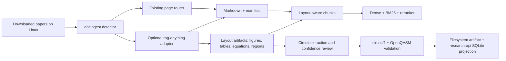

# RAG and multimodal upgrade

This document records the current audit, the integration boundary for `rag-anything`, and the
functional specification for circuit extraction. It is intentionally implementation-oriented: the
existing deterministic pipeline remains the compatibility path while multimodal processing is
introduced behind adapters.

## Audit findings

### Current pipeline

`docingest` already provides:

- per-page PDF routing between text extraction, blank-page detection, and VLM OCR;
- content-addressed normalized Markdown plus `manifest.json` provenance;
- page-aware overlapping chunks;
- dense retrieval, optional BM25 fusion, and cross-encoder reranking;
- whole-block completion for equations, tables, and circuit code;
- deterministic LaTeX circuit parsing into `circuit/1`;
- `quantum-sim` validation and a FastAPI circuit-check surface.

The current index is deliberately simple and reproducible: vectors are stored as float16 shards,
search uses exact cosine similarity, and Tantivy provides the keyword leg. The primary accuracy
risks are layout information being reduced to Markdown, metadata filters being unavailable at
search time, and scanned diagrams that do not contain recoverable LaTeX.

### Persistence gap

The filesystem store persists source-backed circuit readings in `circuits.json` beside each
normalized document. This preserves provenance and is suitable for cache replay, but it is not a
queryable circuit catalog. The API's SQLite database currently stores authentication data only.
The planned persistence boundary is:

1. keep the normalized filesystem result and circuit sidecar as the immutable processing artifact;
2. project validated circuit records into API SQLite for lookup by document, gate, parameter, PSF,
   and validation status;
3. keep the source span, parser/vision confidence, and artifact hash on every projection so the
   projection can be rebuilt safely.

### `rag-anything` compatibility

`rag-anything` is a useful candidate for PDF/Office/image layout decomposition, tables, equations,
and figures. It brings a substantially larger dependency surface (`lightrag`, `mineru`, and
optional OCR/rendering stacks) than the current core. It should therefore be an optional
`DocumentConverter` adapter selected explicitly in configuration, not a mandatory dependency and
not a replacement for the existing per-page OCR route.

The adapter must:

- lazy-import `raganything` and fail with an actionable dependency message when selected but
  unavailable;
- expose a fingerprint containing package/version, parser settings, and model revisions;
- preserve source page/region/figure/table identifiers in conversion metadata;
- write no network-backed state implicitly;
- reject ambiguous extraction rather than silently converting it to executable circuit data.

When raw parser output is enabled, `manifest.json` lists the relative file name in
`raw_artifacts`; the file is written atomically beside `document.md` and is bounded by the
configured maximum size.

## Target architecture



The Linux deployment should pass paths explicitly. The repository must not assume that downloaded
papers live under `data/raw`:

```bash
export RESEARCH_ENGINE_INPUT=/srv/research/papers
export RESEARCH_ENGINE_OUTPUT=/srv/research/normalized
export RESEARCH_ENGINE_DB=/srv/research/api/research.sqlite3
export RESEARCH_ENGINE_CONFIG=/srv/research/pipeline.toml

cd /opt/research-engine
uv run docingest ingest "$RESEARCH_ENGINE_INPUT" \
  --config "$RESEARCH_ENGINE_CONFIG" --index
uv run docingest index build --config "$RESEARCH_ENGINE_CONFIG"
```

The service account running ingestion/API must have read permission on the input directory and
read/write permission on normalized output, index, database, and model-cache directories. When
using containers, mount these paths explicitly at the same container paths or set the equivalent
configuration inside the container.

## Circuit extraction functional specification

### Inputs

- LaTeX circuit blocks (`quantikz`, `Qcircuit`, `yquant`, and supported `tikzcd`);
- rendered PDF/image regions identified as circuit candidates;
- OCR/vision observations containing boxes, wires, labels, gate names, and parameter text;
- source citation: document id, page/segment, figure/region, and byte or character span where
  available.

### Intermediate record

Each observation carries:

| Field | Requirement |
|---|---|
| `kind` | gate, wire, control, measurement, parameter, phase-shift-factor, text |
| `label` | original OCR/LaTeX spelling |
| `normalized_label` | canonical gate/parameter spelling when unambiguous |
| `wires` | 1-based wire numbers or an unresolved wire marker |
| `parameters` | symbolic expressions and normalized angle expressions |
| `confidence` | numeric confidence plus the producing model/parser |
| `source` | document/page/region and source span |
| `review_status` | `accepted`, `needs_review`, or `rejected` |

### Acceptance rules

1. Preserve original observations even when reconstruction is rejected.
2. Do not infer wire order, gate arity, or phase semantics from a low-confidence image alone.
3. Emit `circuit/1` only when all required wires and operations are structurally resolved.
4. Emit OpenQASM only after the circuit/1 representation passes schema validation and the
   simulator's gate/parameter checks.
5. Store PSFs as explicit symbolic metadata; do not fold them into a gate unless the source or a
   deterministic normalization rule proves equivalence.
6. Store validation output, parser version, model revision, and artifact hash with the record.

### Retrieval and API projection

Circuit records should be searchable by document citation, page, gate family, symbolic parameter,
PSF expression, validation status, and extraction confidence. Embeddings are references to the
same index generation used for text retrieval; a circuit projection must never claim to be
searchable if its vector generation is stale or absent.

## Rollout and measurements

The implementation is staged so existing behavior remains measurable:

1. establish current retrieval/circuit baselines;
2. add layout metadata and optional adapter without changing default outputs;
3. add filtered retrieval and circuit projections;
4. compare OCR/diagram extraction against checked-in fixtures and manually reviewed samples;
5. enable the optional adapter only in Linux configurations that declare its dependencies and
   model/cache paths.

Track retrieval recall/precision, ingestion throughput, OCR rejection rate, circuit structural
acceptance, PSF extraction precision, and the percentage of accepted circuits validated by
`quantum-sim`.
