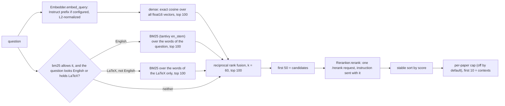

# docingest-index

Embedding and reranker clients and a persistent chunk index for [docingest](../docingest/README.md). It plugs into docingest as three adapters, found by entry point, so docingest's core does not depend on numpy search code or tantivy.

| Adapter | `[adapters]` entry | Port | What it is |
|---|---|---|---|
| `OpenAICompatibleEmbedder` | `embedder = "openai-compatible"` | `Embedder` | HTTP client for `/v1/embeddings` (vLLM serving Qwen3-Embedding). Batches, retries, L2-normalized float32 vectors, Qwen3 query instruction. |
| `LocalIndex` | `index = "local"` | `ChunkIndex` | Vectors and chunks on disk (float16 numpy shards), exact cosine search, a tantivy BM25 index, reciprocal rank fusion. |
| `VllmReranker` | `reranker = "vllm"` | `Reranker` | HTTP client for vLLM's `/rerank` (Qwen3-Reranker): one request, one score per chunk. |

The design and its measurements are in [ADR 0004](../docingest/docs/adr/0004-chunk-index-and-two-stage-retrieval.md). The ports and their contracts are in [docingest's ports README](../docingest/src/docingest/ports/README.md).

## Contents

- [Use it](#use-it)
- [How a question is answered](#how-a-question-is-answered)
- [The index on disk](#the-index-on-disk)
- [Keeping the index in step with the corpus](#keeping-the-index-in-step-with-the-corpus)
- [Configuration](#configuration)
- [Code map](#code-map)
- [Tests and checks](#tests-and-checks)
- [Limits](#limits)

## Use it

The embedder and the reranker run as model servers; [`serving/`](../../serving/README.md) starts them (`qwen-embed` on port 8002, `qwen-rerank` on port 8003). Select the adapters and point the tables at the servers (all keys: [config/README.md](../docingest/config/README.md#index-embedder-and-reranker-docingest-index)):

```toml
[adapters]
embedder = "openai-compatible"
index = "local"
reranker = "vllm"

[embedder]
base_url = "http://127.0.0.1:8002/v1"

[reranker]
base_url = "http://127.0.0.1:8003"
```

Then, from `packages/docingest` with the corpus already ingested:

```bash
uv run docingest index build      # embed the new and changed papers, commit
uv run docingest index status     # what is indexed, what is searchable, what a build would do
uv run docingest index remove 3fa9c2d1
```

`index build` is incremental: a second run over an unchanged corpus makes no embedding request. With the adapters selected, `docingest ask` answers from the index: it embeds the question, takes the top `candidates` (50) from the index, reranks them and gives the best `contexts` (10) to PaperQA2, which writes the cited answer. PaperQA2 first summarizes those chunks, unless `[qa] skip_summary = true`, which the lab example sets: then the answer model reads the chunks themselves. `ask --no-index` goes back to PaperQA2's own retrieval, `ask --bm25 english|always|never` overrides the keyword setting for one question, and `ingest --index` and `crawl --index` add the papers they store to the index (off by default).

```bash
uv run docingest ask "What limits T1 in transmons?"
uv run docingest ingest data/raw --index
```

A complete setup for a lab server with the three model servers of [`serving/`](../../serving/README.md) is [`config/examples/lab-server.toml`](../docingest/config/examples/lab-server.toml).

In Python, through the container (the adapters are the ones above):

```python
from docingest.bootstrap import Container
from docingest.config import load_config

c = Container(load_config("config/pipeline.toml"))
c.index_service.build()
question = "What limits T1 in transmons?"
vector = c.adapter("embedder").embed_query(question)
hits = c.adapter("index").search(question, vector, 50)           # first stage
scores = c.adapter("reranker").rerank(question, [h.chunk for h in hits])
```

## How a question is answered



`LocalIndex.search` is the part up to the candidates. The reranker call, the final sort and the optional per-paper cap are done by the caller (`AskService.retrieve` in docingest); scores come back in input order and ties keep the first-stage order. These are the formulas of the measured end-to-end retrieval, and `tests/test_retrieval_oracle.py` compares them with a literal copy of that script:

- Dense: vectors are unit length, so the score is a dot product; computed in float32 over float16 storage, in blocks of 16,384 rows. The float16 matrix is converted to float32 once, at the reader's first dense search, and the copy stays in memory until `close()` or a new object; the products, and so the scores, are the same as converting block by block for every question. Ranking by `argpartition` and a stable sort. The chunk records of the hits are cut from the memory-mapped `chunks.jsonl` in file order instead of one seek and read per record.
- BM25: the question reduced to lowercased ASCII letters and digits, parsed by tantivy as an OR query over a field tokenized with `en_stem`. A question with none of those characters has no keyword part.
- LaTeX: under `bm25 = "english"`, a question that is not English but holds LaTeX also gets BM25, over the words of its LaTeX only (`latex.py`), because the dense embedder places a quoted formula poorly (in a probe with English questions that quote a formula, the dense ranking left two of them out of its top 100, where BM25 over the whole question ranked them 3rd and 1st) and the prose words of a Spanish question rarely occur in an English corpus. An English question is unchanged: BM25 over all its words. `bm25 = "never"` (and `--bm25 never`) stays off for every question, `"always"` searches every word.
- What counts as LaTeX: math between `$...$` (the opening `$` is followed by a non-space, the closing one is preceded by a non-space and not followed by a digit, and the inside is not prose or money, that is a word of three letters, or only numbers and words of one or two letters with two numbers or more, so "costs $5 and $10", "entre $5 y 10$", "$1.000 y 2.000$" and "$5 and 10$" are not math but "$n - 1$" and "$2 x$" are), `$$...$$`, `\(...\)` or `\[...\]`; outside delimiters, a word with a backslash command of two or more letters (`\frac`, `\sum`, `\ket`; a Windows path such as `C:\Users\me` is not one) or a subscript or superscript in braces (`x_{i}`, `10^{-3}`). Plain `snake_case`, `2^10`, `\n` and a bare `T_1`, `x_i` or `x^2` are not LaTeX: a bare mark is as likely a name or a variable as math, and a keyword ranking built from it has little to do with the dense one. Math between delimiters is read up to 1,000 characters. Even then the LaTeX of a question is searched only when it holds a token of two letters or more (`frac`, `omega`, `mc`) or at least three tokens, counting the whole question, so `$x$`, `$T_1$`, `$f(x)$`, `$k = 2$` and a lone `x_{i}` or `10^{-3}` do not start a keyword search. The detection is a few regular expressions and does not run on a question that has none of `\`, `$`, `^` or `_`.
- How LaTeX meets the index: no change to the index. The chunks keep their LaTeX as written, and `en_stem` splits at every character that is not a letter or a digit, so `\frac{n!}{(n/2)!}` is indexed as `frac`, `n`, `n` and `2`; the query goes through the same reduction, so a command, a brace or a subscript matches by its letters and digits. The characters of the notation themselves (`\`, `{`, `^`, `_`) are not searchable, so `x_i` and `x^i` are the same query, and the command `\ket` is the same token as the word "ket". Unicode symbols in a question (for example `α`) are dropped by the ASCII reduction, as they always were.
- Fusion: an item scores the sum of `1 / (60 + rank)` over the rankings that contain it (rank from 1); ties keep the order of first appearance, dense first.
- Whether a question is English is decided from its function words (`language.py`); `bm25 = "always"` skips the test.

## The index on disk

```text
<index.dir>/<model-slug>-<fingerprint8>/
  fingerprint.json    corpus, model, revision, vector length (seen at the first commit), dtype,
                      query instruction, chunker version and settings, format
  shards/<doc_id[:16]>-<key[:16]>.npz     float16 unit vectors of one paper
  shards/<doc_id[:16]>-<key[:16]>.jsonl   header line, then one line per chunk:
                                          name, pages, character span, is_reference, text
  search/dense.npy, chunks.jsonl, chunks.offsets.npy, ids.json, bm25/
                      everything search() reads, rebuilt from the shards by commit(); never embeds
  state.json          documents, chunks and time of the last commit
  .lock               held by the process that writes
```

- **One folder per corpus and setting.** The folder name is the model slug and the first 8 hex digits of a SHA-256 over the index fingerprint: the corpus (the resolved `output_dir` of the config), the embedder's identity (model, revision, normalization), the vector dtype, the chunker version, `[qa] chunk_chars` and `overlap`, and the format version. Change any of them and a new, empty folder is used. Several corpora can share one `[index] dir`: each gets its own folder, so building one never prunes another; a corpus folder that moves is a new index (the old folder can be deleted). Indexes of two models never mix. The `query_instruction` is written to `fingerprint.json` but is not part of the hash: it changes only the vector of a question. The vector length is not a setting: it is recorded in `fingerprint.json` at the first commit, and vectors of another length are refused.
- **Shards are the source of truth for what is stored.** `upsert` writes the `.npz` and then the `.jsonl` (the `.jsonl` marks the shard valid) through temporary files and renames, under a name no other shard uses (`-1`, `-2` are appended when the name is taken, for example when the same key is stored again), and deletes the paper's older shard only after that. A crash leaves the old shard or the new one, never a mixture; the leftovers are cleaned up by the next writer.
- **`search/` is what questions are answered from.** `commit` copies the vectors and the chunk records of every shard into a new `search/` (with the BM25 index) next to the old one and swaps the folders. `search` reads nothing outside `search/`, so it answers from the last commit even while shards are being replaced or removed, by this process or another. After `commit`, `search` reflects exactly what `keys()` reports. `stats().pending` is true when the shards differ from what `search/` was built from, in any document.
- **The check before a question.** `committed()` answers which documents the last commit holds and whether changes are waiting, from `search/ids.json` and the file names in `shards/` (a shard counts when its `.jsonl` and `.npz` both exist). It also names the commit: `generation` is the id in `ids.json`, new with every commit, which a long-lived reader compares to know that it must reopen. It opens no shard, unlike `stats()` and `keys()`, which read every header; `docingest ask` uses it, `index status` and `build` keep the full scan. Both answer the same for the same states, which the contract test checks, except for a shard whose `.jsonl` header cannot be read: only `stats()` and `keys()` notice it (they drop it), `committed()` counts it from its file name. `ask` asks `stats()` before it warns about pending changes, so an unreadable shard that no commit knows does not warn after every build.
- **Readers and writers.** Reading (`keys`, `stats`, `committed`, `search`, so `docingest index status`) never creates, changes or deletes a file. A reader opens one commit whole (vectors, chunk records and the BM25 index) at its first search and keeps that commit while it stays open, however many commits other processes make; `close()` or a new object sees the latest. `ids.json` carries a generation id per commit, so an open that a commit interrupts starts over. The first write takes an exclusive `flock` on `.lock` and holds it until `commit` returns or `close()` is called; a second writer fails at once with `IndexBusyError`, naming the folder. `begin_write()` takes the lock without writing; `docingest index build` and the `--index` updates call it before they embed anything, so the second of two concurrent builds fails before any embedding request. Under the lock the first write removes temporary files, vectors without chunks and the older of two shards of one paper (the one with the smaller write counter `seq` in its header; every `upsert` writes a counter larger than any shard on disk).
- Ids that are not filename-safe are hashed in the shard name.

## Keeping the index in step with the corpus

`IndexService` (in docingest) calls the port; this package only stores. A paper's key is the SHA-256 of its page numbers and texts, so a paper is embedded again only when its text changed. Vectors are never recomputed by `commit`. `index build` also removes papers that left the corpus (`--no-prune` keeps them) and refuses to run when the index records another embedder fingerprint than the configured one (`IndexMismatchError`).

## Configuration

`[index]`, `[embedder]` and `[reranker]` are described key by key in [docingest's config README](../docingest/config/README.md#index-embedder-and-reranker-docingest-index). The factories read them from `AppConfig.model_extra` and validate them with the models in `settings.py`; unknown keys are errors. `candidates`, `contexts` and `max_chunks_per_paper` are read by `docingest ask` itself, which may not import this package: `IndexSettings` inherits them (and their defaults, `DEFAULT_MAX_CHUNKS_PER_PAPER` among them) from `docingest.config.IndexConfig`, the small model docingest reads the same table with. `LocalIndex.search` does not apply `max_chunks_per_paper`: `ask` does, after reranking.

## Code map

| Module | Contains |
|---|---|
| `settings.py` | `IndexSettings`, `EmbedderSettings`, `RerankerSettings`, `load`: the three tables, their defaults and the pinned default models |
| `http.py` | `JsonClient` (one POST with retries, bearer key from an environment variable, no redirects) and `RemoteServiceError` |
| `embedder.py` | `OpenAICompatibleEmbedder`, `embedder_fingerprint`, `format_query`, `normalize` |
| `reranker.py` | `VllmReranker` |
| `local.py` | `LocalIndex`: shards, `commit`, `search`, the on-disk format |
| `fusion.py` | `rrf` |
| `language.py` | `looks_english` |
| `latex.py` | `latex_text`, `has_latex`: the LaTeX of a question, for BM25 on non-English formula questions |
| `factories.py` | The three `(AppConfig) -> adapter` functions that the entry points name |

The import-linter contract in `pyproject.toml` lets this package import only `docingest.ports`, `docingest.domain` and `docingest.config`.

## Tests and checks

```bash
./scripts/check.sh      # ruff, ruff format, import-linter, pyright, pytest with an 85% coverage floor
```

No test needs a GPU or the network: the clients run over `httpx.MockTransport` (`tests/servers.py`) and the index over real numpy and tantivy on temporary folders.

| Module | Covers |
|---|---|
| `test_contract.py` | docingest's retrieval contract (`tests/contract/test_retrieval_contract.py` of the docingest package, imported through `tests/conftest.py`) against the real embedder, index and reranker |
| `test_embedder.py`, `test_reranker.py` | request bodies equal to the ones of the measured scripts, batching and order, normalization, retries, errors, keys |
| `test_local_index.py` | layout, round trip, incremental add, change and remove, commit visibility, recovery after a crash, the write counter, a reader that stays open across another process's commit (one generation), `committed().generation` (the id of `ids.json`, new with every commit and only then), `close()`, folder separation by fingerprint, RRF on a hand-checked example, English-only BM25, BM25 on the LaTeX of a non-English question (a fixture where the formula chunks are found only through the keyword ranking, the prose words left out, the `never` setting and override still off) and the `keywords` override, the index leaving the per-paper cap to `ask`, blocks and depths, scores and records bit-identical to converting per question, the float32 copy made once per reader |
| `test_retrieval_oracle.py` | the fused top 50 equals a literal copy of the measured retrieval script |
| `test_fusion.py`, `test_language.py`, `test_latex.py`, `test_settings.py`, `test_factories.py` | the helpers, the config tables and the entry points |
| `test_concurrent_build.py` | a second `IndexService.build` or `update` while the first is embedding fails with the busy error and sends no embedding request; the lock is free again afterwards |
| `test_cli_end_to_end.py` | `docingest index build`, `status` and `remove` through the real CLI, store, entry points, client and index; `ask` through the real embedder, index and reranker (scripted servers) with a fake answerer; a build that fails between two papers does not lock a retry |
| `test_example_config.py` | `config/examples/lab-server.toml` loads, names real adapters and talks to 127.0.0.1 only; no shipped config holds an absolute path of a machine |

CI runs the same gates on Linux (core and dev dependencies) and macOS (everything installed); see [`.github/workflows/ci.yml`](../../.github/workflows/ci.yml).

## Limits

- Exact search keeps the dense matrix as a float16 file and, in an open reader, as a float32 copy in memory, twice the size of the file (4 bytes per dimension per chunk, plus the pages of the mapped file the operating system keeps in its cache). It is fine to roughly 10,000 papers (about 100,000 chunks of 2,560 dimensions: 0.5 GB on disk, 1 GB for the copy). Beyond that, approximate search is a separate decision.
- One process writes to an index folder at a time (enforced by the lock); readers can run alongside because `search` reads only the committed `search/` folder. The lock is an `flock` on a local file: use a local disk, not a network share.
- The English test is a function-word count, not a language identifier. The LaTeX test is a pattern match: a formula typed without delimiters or commands (`E = mc^2`) is not seen, and a bare `T_1` or `x^2` is not counted. The two rankings weigh the same in the fusion whatever the quality of the keyword query, so in a question with LaTeX about half of the 50 candidates come from the keyword ranking; the words of a short or generic formula (`e n omega frac`) make a weak query, much weaker than the whole question, which is why a formula with fewer than three tokens and no word is left out.
- BM25 ties are broken by tantivy's document order; the index is written with one thread so that order is the same in every build.
