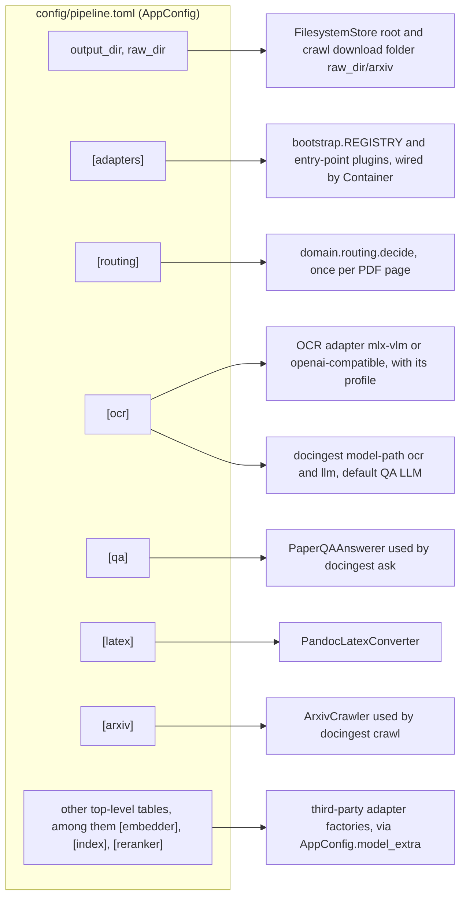
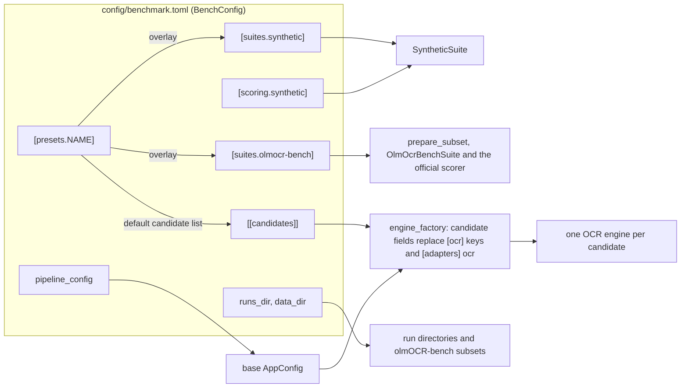
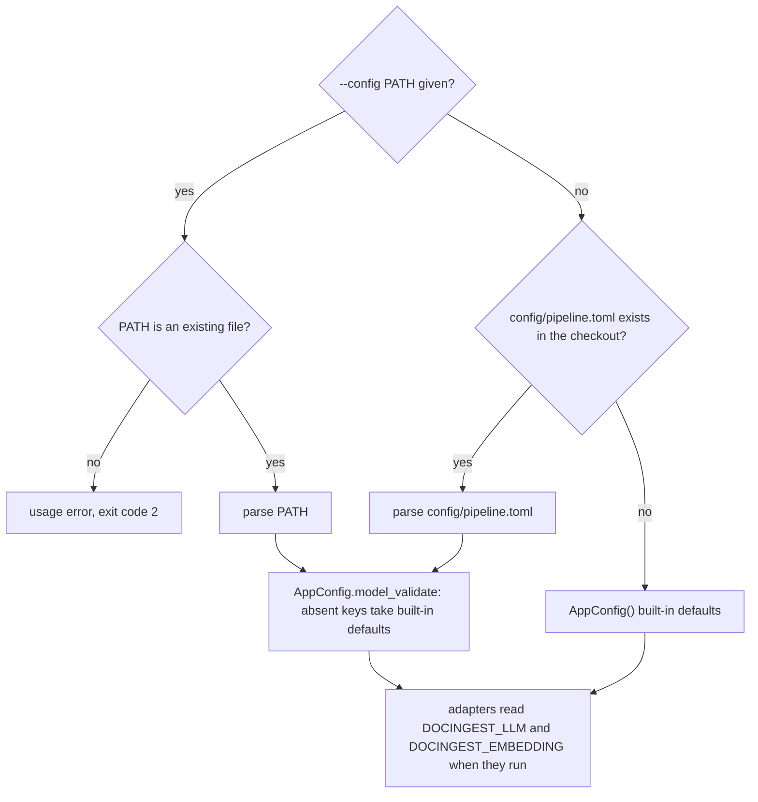
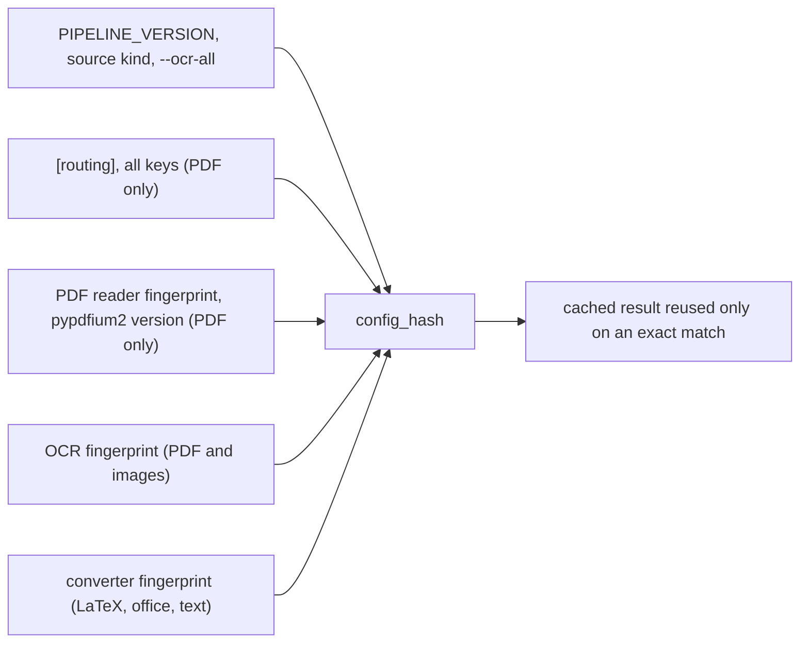

# Configuration

docingest is configured with TOML files in this directory. There are two schemas:

| File | Schema (source of truth) | Read by | Purpose |
|---|---|---|---|
| `pipeline.toml` | `AppConfig` in [`src/docingest/config.py`](../src/docingest/config.py) | `docingest ingest`, `crawl`, `eval-ocr`, `ask`, `adapters`, `model-path`; the PaperQA2 hook; `docingest bench run` as the base OCR configuration of every candidate (through `pipeline_config`) | Which adapter plugs into each port, and the settings of those adapters. |
| `benchmark.toml` | `BenchConfig` in [`src/docingest/entrypoints/bench_cli.py`](../src/docingest/entrypoints/bench_cli.py) | `docingest bench prepare`, `run`, `score`, `report`, `candidates` | OCR benchmark: suites, candidates, presets, scoring options. |
| `examples/remote-ocr.toml` | `AppConfig` | any pipeline command, with `--config` | OCR through an OpenAI-compatible vision endpoint instead of in-process MLX. |
| `examples/ollama-qa.toml` | `AppConfig` | any pipeline command, with `--config` | PaperQA2 answers with Ollama models. |

Every key, type and default below is taken from those models: the Pydantic models in `config.py` (plus `RoutingPolicy` in `src/docingest/domain/routing.py` for `[routing]`), the Pydantic settings classes in `bench_cli.py`, and the `CandidateSpec` dataclass in `src/docingest/ports/benchmark.py` for `[[candidates]]`. When a table says "Default", it is the model's default, which applies when the key is absent from the file. The values written in `pipeline.toml` are currently identical to the built-in defaults of `AppConfig`.

Contents:

- [How configuration reaches the code](#how-configuration-reaches-the-code)
- [Selecting and overriding a configuration](#selecting-and-overriding-a-configuration)
- [Validation](#validation)
- [`config/pipeline.toml` reference](#configpipelinetoml-reference): [top level](#top-level-keys), [`[adapters]`](#adapters), [`[routing]`](#routing), [`[ocr]`](#ocr), [`[qa]`](#qa), [`[latex]`](#latex), [`[arxiv]`](#arxiv), [plugin sections](#plugin-sections), [`[index]`, `[embedder]` and `[reranker]`](#index-embedder-and-reranker-docingest-index)
- [Pinning models by revision](#pinning-models-by-revision)
- [What invalidates cached outputs](#what-invalidates-cached-outputs)
- [Example configurations](#example-configurations)
- [`config/benchmark.toml`](#configbenchmarktoml): [top level](#top-level-keys-1), [suites](#suitessynthetic), [candidates](#candidates), [presets](#presetsname), [scoring](#scoring)
- [Environment variables](#environment-variables)
- [Recipes](#recipes)

## How configuration reaches the code

Each section of `pipeline.toml` configures one part of the system. `[adapters]` chooses the implementations; the other sections are handed to those implementations by the composition root, `docingest.bootstrap`.



The benchmark file is read only by `docingest bench`. Its `pipeline_config` key points back to a pipeline file, whose `[ocr]` model and generation keys and `[adapters] ocr` each candidate then overrides (its other settings, such as `[ocr] base_url`, are kept).



## Selecting and overriding a configuration

For the pipeline commands (`ingest`, `crawl`, `eval-ocr`, `ask`, `adapters`, `model-path`) the file is chosen as follows. The logic is `config.load_config` plus the CLI's `--config` option.



Rules to keep in mind:

1. **One file, no merging.** A file given with `--config` replaces `pipeline.toml`; it is not layered on top of it. Keys it leaves out take the defaults in `config.py`, not the values in `pipeline.toml` (today those are the same values). This is why `examples/ollama-qa.toml` can set only `output_dir`, `raw_dir` and `[qa]`.
2. **The default file is found from the package location.** `DEFAULT_CONFIG` is `<repository>/config/pipeline.toml`, computed from `src/docingest/config.py`, so it is found from any working directory in a source checkout (the project installs the package in editable mode). If the package runs from a location where that file does not exist, the built-in defaults are used.
3. **An explicit path must exist.** `load_config(path)` raises `FileNotFoundError` for a missing file, and the CLI rejects it before that with exit code 2. A typo never silently switches to another pipeline.
4. **Relative paths resolve against the working directory.** `output_dir`, `raw_dir` and every path in `benchmark.toml` are used as given, so run commands from the package folder (`packages/docingest`).
5. **There are no per-key command-line overrides.** To change a setting for one run, copy the file, edit the copy and pass it with `--config`. The command-line options that affect processing are listed in [../src/docingest/entrypoints/README.md](../src/docingest/entrypoints/README.md) (`--force`, `--ocr-all`, `--max-pages`, and the `bench` options).
6. **Only two pipeline settings have environment overrides**, both for question answering: `DOCINGEST_LLM` and `DOCINGEST_EMBEDDING` (see [Environment variables](#environment-variables)).
7. **The PaperQA2 hook** (`docingest.entrypoints.paperqa_hook`) has no configuration parameter. It always uses the default file (rule 2).
8. **One canonical result per document and `output_dir`.** The store keeps the canonical result of a document in `<output_dir>/<sha256[:16]>/`. Ingesting the same file with a configuration that changes its cache key re-processes it and replaces that result. To keep the results of two configurations side by side, give them different `output_dir` values.

The benchmark commands choose their file with their own `--config` option (default: `<repository>/config/benchmark.toml`, found from the package location). `bench run` then loads the pipeline file named by `pipeline_config` with the same `load_config` function, so the rules above apply to it too.

From Python:

```python
from pathlib import Path

from docingest.config import load_config

cfg = load_config()                                           # config/pipeline.toml, or defaults
remote = load_config(Path("config/examples/remote-ocr.toml"))  # must exist
print(remote.adapters.ocr, remote.ocr.repo_id, remote.ocr.revision)
```

## Validation

`load_config` parses the file with `tomllib` and validates it with Pydantic. A failure raises `pydantic.ValidationError` (the CLI shows a traceback and exits with code 1).

| Situation | Result |
|---|---|
| TOML syntax error | Error (`tomllib.TOMLDecodeError`). |
| Unknown key inside `[adapters]`, `[routing]`, `[ocr]`, `[qa]`, `[latex]` or `[arxiv]` | Error (`extra_forbidden`). |
| `[routing] blank_max_chars` below 0, `blank_max_ink` outside 0 to 1, `blank_ink_contrast` outside 1 to 255, `blank_dark_page` outside 1 to 255, `scan_image_cover` of 0 or less, or above 1, `math_min_equals` below 1, `math_min_density` of 0 or less, or above 1 | Error. |
| Unknown top-level table or key | Kept in `AppConfig.model_extra` for plugins; no error. |
| Value that cannot be converted to the declared type (for example `dpi = "high"`) | Error. |
| `[ocr] repo_id` other than the default without `revision` | Error: `[ocr] revision is required for '<repo>': pin a commit sha of that repo`. |
| Unknown adapter name in `[adapters]` | Not checked at load. Fails when that adapter is built: `unknown <port> adapter '<name>'; available: [...]`. `docingest adapters` shows it as `(unknown)`. |
| Unknown `[ocr] profile` | Fails when the OCR adapter is built: `unknown OCR profile ...; choose from [...]`. |
| `[arxiv] prefer` empty or with values other than `latex`, `pdf` | Fails when the crawler is built. |
| `[ocr] base_url` not starting with `http://` or `https://` | Fails when the `openai-compatible` adapter is built. |

## `config/pipeline.toml` reference

### Top-level keys

| Key | Type | Default | Meaning |
|---|---|---|---|
| `output_dir` | string (path) | `"data/normalized"` | Root of the document store (`FilesystemStore`): canonical results, `_variants/`, `_degraded/`, `index.json`. Read by `ingest`, `crawl`, `eval-ocr`, `ask` and the hook. |
| `raw_dir` | string (path) | `"data/raw"` | `docingest crawl` downloads into `<raw_dir>/arxiv/`. `ingest` does not read it; pass input paths explicitly. |

### `[adapters]`

Selects the implementation plugged into each port. A value is either a built-in name from `bootstrap.REGISTRY` or the name of an installed entry point in the group `docingest.<port>` (a built-in wins a name clash). `docingest adapters` lists what is available. Writing a new adapter is covered in [../src/docingest/adapters/README.md](../src/docingest/adapters/README.md) and the port contracts in [../src/docingest/ports/README.md](../src/docingest/ports/README.md).

| Key (port) | Type | Default | Built-in names | Port protocol | Built when |
|---|---|---|---|---|---|
| `detector` | string | `"magic"` | `magic` | `TypeDetector` | the ingestion service is first used |
| `pdf` | string | `"pdfium"` | `pdfium` | `PdfReader` | the ingestion service is first used |
| `ocr` | string | `"mlx-vlm"` | `mlx-vlm`, `openai-compatible` | `OcrEngine` | the ingestion service is first used (the model itself loads on the first page that needs OCR) |
| `images` | string | `"pillow"` | `pillow` | `ImageSource` | the ingestion service is first used |
| `office` | string | `"docling"` | `docling` | `DocumentConverter` | the first DOCX, PPTX, XLSX or HTML input |
| `latex` | string | `"pandoc"` | `pandoc` | `DocumentConverter` | the first LaTeX input |
| `text` | string | `"passthrough"` | `passthrough` | `DocumentConverter` | the first Markdown or text input |
| `multimodal` | string | `"none"` | `none`, `rag-anything` | `AsyncDocumentConverter` | `docingest ingest-async` |
| `store` | string | `"filesystem"` | `filesystem` | `DocumentStore` | the ingestion service or `ask` is first used |
| `qa` | string | `"paperqa"` | `paperqa` | `QuestionAnswerer` | `docingest ask` |
| `crawler` | string | `"arxiv"` | `arxiv` | `SourceCrawler` | `docingest crawl` |
| `embedder` | string | `"none"` | `none` (plugin `docingest-index`: `openai-compatible`) | `Embedder` | `docingest index`, `ingest --index`, `crawl --index`, or `ask` with an index |
| `index` | string | `"none"` | `none` (plugin `docingest-index`: `local`) | `ChunkIndex` | `docingest index`, `ingest --index`, `crawl --index`, and `docingest ask` whenever it is set |
| `reranker` | string | `"none"` | `none` (plugin `docingest-index`: `vllm`) | `Reranker` | `docingest ask` with an index; `none` keeps the first stage's order |

The three retrieval ports have only the `none` built-in, which refuses to work (`NotConfiguredError`). **`index` decides how `ask` answers:** with `index = "none"` (the default) `ask` behaves exactly as before, PaperQA2 retrieving its own evidence; with a real index it retrieves from the index and needs an `embedder` too (an index without one is an error that names the key). Selecting only an `embedder` or a `reranker` changes nothing for `ask`. The `docingest-index` package brings the real adapters (`openai-compatible`, `local`, `vllm`) and reads its own tables, [`[index]`, `[embedder]` and `[reranker]`](#index-embedder-and-reranker-docingest-index).

Set `multimodal = "rag-anything"` only after installing the optional extra. It is used by the
asynchronous `ingest-async` command for PDF, Office, and image inputs; the regular `ingest`
command continues to use the page router and synchronous converters.

### `[rag_anything]`

| Key | Type | Default | Meaning |
|---|---|---|---|
| `parser` | string | `"mineru"` | rag-anything parser name. |
| `method` | string | `"auto"` | Parser method. `auto` selects MinerU `flash`/`txt` when a PDF has a text layer and the configured OCR tier/mode otherwise; `txt` forces `flash`/`txt`. |
| `tier` | string | `"standard"` | MinerU 4 tier. Use `flash` for text-layer extraction or `standard` for local OCR/layout parsing. |
| `ocr_mode` | string | `"ocr"` | MinerU 4 OCR mode. `txt` reads only an existing PDF text layer; `ocr` processes scanned pages and images. |
| `output_dir` | path | `"data/rag-anything"` | Parser intermediates; use persistent Linux storage. |
| `raw_output` | bool | `true` | Retain parser blocks in `rag-anything.json` beside the normalized result. |
| `require_layout` | bool | `false` | Reject MinerU 4 output when structured layout JSON is missing. |
| `max_raw_bytes` | int | `268435456` | Maximum serialized raw parser output per document. |
| `lang` | string or null | `null` | Optional parser language hint. |
| `max_concurrency` | int | `1` | Maximum concurrent async conversions (`1` to `16`). |

For `parser = "mineru"`, docingest invokes the MinerU 4 `mineru-kit parse` command directly.
This avoids the legacy `mineru -p` command used internally by rag-anything 1.4.3. The
`standard`/`ocr` combination is required for scanned PDFs and images and requires the
corresponding MinerU 4 engine and model files. `flash`/`txt` is a local, text-layer-only
fallback and does not perform OCR.

### `[routing]`

Thresholds of the pure routing policy `domain.routing.RoutingPolicy`, applied to every PDF page by `decide()`. The PDF adapter measures the page signals; a page is sent to OCR when **any** rule below matches, and the reasons are written into the page's probe in `manifest.json`. With `docingest ingest --ocr-all`, a page that matches no rule is sent to OCR with the reason `forced (--ocr-all)`. Images always go to OCR; converters never do. The rationale is in [../docs/adr/0002-per-page-routing-and-content-addressed-cache.md](../docs/adr/0002-per-page-routing-and-content-addressed-cache.md).

| Key | Type | Default | Rule |
|---|---|---|---|
| `min_chars` | int | `50` | OCR when the page has fewer embedded characters than this. |
| `image_coverage` | float (fraction) | `0.6` | OCR when image objects cover at least this fraction of the page area... |
| `image_coverage_max_chars` | int | `400` | ...and the page has fewer embedded characters than this. |
| `max_garbage_ratio` | float (fraction) | `0.10` | OCR when more than this share of the non-space characters are replacement, control, private-use or `(cid:N)` glyphs (broken font encoding). |
| `min_alpha_ratio` | float (fraction) | `0.5` | OCR when the page has at least `min_chars` characters but less than this share of its non-space characters are letters (olmOCR heuristic for a bad text layer). |
| `blank_max_chars` | int | `10` | A page that matched an OCR rule above is **blank** when it has at most this many embedded characters (a page number, a roman numeral)... |
| `blank_max_ink` | float (fraction) | `0.0005` | ...and fewer than this share of its pixels are ink. A blank page is not sent to OCR: it becomes an empty page with method `blank`. `0` turns the rule off. |
| `blank_ink_contrast` | int (grey levels) | `32` | A pixel is ink when, after a 3x3 median filter, it is this many grey levels darker than the page's background (the median grey of the page). Paper tint, grey paper, scanner noise and show-through inside this margin are not ink; the faint text of a faded copy (35 to 45 levels darker) is. |
| `blank_dark_page` | int (grey level) | `128` | A page whose median grey is below this is not paper (a black cover, a full-bleed picture) and counts as all ink. |
| `scan_layer_to_ocr` | bool | `true` | OCR when the page is a scan (images cover at least `scan_image_cover` of it) and has a text layer of at least `min_chars` characters. `false` keeps the text layer of such pages. |
| `scan_image_cover` | float (fraction, above 0 up to 1) | `0.8` | The share of the page area that image objects must cover for a page to count as a scan in the rule above. |
| `math_to_ocr` | bool | `false` | OCR when the page has a text layer of at least `min_chars` characters and is math-heavy: at least `math_min_equals` equals signs or a math-symbol share of at least `math_min_density`. `false` (default) keeps the text layers of such pages. |
| `math_min_equals` | int (1 or more) | `5` | Equals signs in the text layer from which a page counts as math-heavy. Used only when `math_to_ocr` is true. |
| `math_min_density` | float (fraction, above 0 up to 1) | `0.04` | Share of math-symbol characters among the non-space characters from which a page counts as math-heavy. Used only when `math_to_ocr` is true. |

Unknown keys in this table are an error (see [Validation](#validation)).

**Scans with an OCR text layer.** An old paper scanned and run through an OCR program has one image the size of the page and, over it, a hidden text layer with that program's output. docingest used to trust that layer unless it was short (`image_coverage` rule), garbled or mostly non-letters. On the reference corpus (41 documents, 3,816 pages) the rule fires on 595 pages in 19 documents. 593 of them, in 17 documents, are scans of this kind, and their layers were the weakest text of the corpus: forcing the model on 47 sampled pages lowered the character error rate of plain text from 0.068 to 0.011 (40 pages better, 1 worse) and of math from 0.43 to 0.03. The two others are not scans: a book cover (a full-page picture with 53 characters, already sent to OCR by the `image_coverage` rule) and a textbook page whose figure is made of 2,719 tiny images, which is why coverage is measured as a union (below). With `scan_layer_to_ocr = true` such a page is rendered and read by the OCR engine like any scan, and its reason in the manifest reads `scanned page with a text layer: images cover 99% of the page, 2500 embedded chars`.

The page is a scan when the images cover at least `scan_image_cover` of the visible page box. Coverage is the **union** of the image rectangles, so images drawn over each other, or a figure cut into many pieces, count once: the PDF reader version 2 measures it (a sum of areas capped at 1 measured that figure page at 1.0, the union measures it at 0.13). One image is exact; several are drawn on a 200 by 200 grid with each edge rounded to the nearest grid line, which is within half a cell (0.25%) of each image edge. On the corpus, the scan pages cover 0.88 to 1.0, and no page that is not a scan reaches 0.8 once coverage is a union, except the cover above. That is how 0.8 was chosen; the page class was not used to pick the pages, and 0.9 would miss one scan page (0.883).

**Known limit.** The rule looks at the images and the amount of text, not at whether the text is hidden. A born-digital page drawn over one full-page background image (slides exported from a template, posters, publisher covers, a letterhead or watermark stored as an image) with a long visible text layer is read by the OCR engine too, which costs time and can change correct text. None of the corpus pages the rule fires on is of this kind, apart from the cover above. Set `scan_layer_to_ocr = false` for a collection of such documents. Telling hidden text from visible text would need a new page signal and is not part of this rule.

The text layer is kept as the fallback: when the OCR output is rejected (a loop, more text than the page can hold, a repeat of an earlier page) the page takes its text layer, with a warning in the manifest, exactly as for any other page that has one.

The price is time: the model needs about 29 seconds per page on the lab GPU server (28.7 s mean for scanned pages on the sample, p90 43.9 s and maximum 69.4 s over 97 text-layer pages) where the text layer took milliseconds. For the reference corpus that is about 4.6 hours of GPU for the 578 scan pages that were not on OCR already (578 x 28.7 s). Pages of this kind with fewer than `image_coverage_max_chars` characters were already sent to OCR by the `image_coverage` rule, which stays as it is; `scan_layer_to_ocr = false` does not change that. The two keys are part of the PDF cache key, and the PDF reader fingerprint carries a version of its measurements (`pypdfium2 <version> signals 2`), so the first run after upgrading re-processes every PDF in an existing output folder, not only the rerouted pages; turning the rule on or off or moving the threshold does the same. Changing a signal of the PDF reader invalidates PDF results only, never images or converted documents. On the reference corpus no routing decision changed except that of the one page it was introduced for: the 66 pages that rule 2 sends to OCR (coverage 0.6 or more, fewer than 400 characters) are the same set, and the rule 5 set lost the figure page and gained none.

**Math pages.** A born-digital page with a lot of math has a text layer that loses the structure of formulas: fractions, scripts, sums and matrices come out as loose characters in a line. The model reads such pages as LaTeX. `math_to_ocr = true` sends a page with a text layer of at least `min_chars` characters to OCR when it has at least `math_min_equals` equals signs or when math symbols are at least `math_min_density` of its non-space characters. Math symbols are Greek letters, arrows, mathematical operators, technical brackets, the mathematical alphabets, the letterlike block and `± × ÷ √ ∞ ∑ ∏ ∫ ≈ ≠ ≤ ≥ ⊗ ⊕ † ˆ`; ASCII `+ - < >` are not counted. The set is deliberately broad: text in Greek counts as math symbols (a Greek sentence measures a density of 1.0), and so do `™`, `№` and `℠` (letterlike symbols), so leave the rule off for a collection in Greek. Both numbers are signals of the page (`eq_signs`, `math_density`), measured from the text layer by the PDF reader and recorded in the manifest probe whether the rule is on or not. The reason in the probe reads `math-heavy page with a text layer: 12 '=' signs, math symbols 5.0% of the characters`. Results cached before this version carry no such measurement and show 0 for both signals; routing never reads a cached probe, so this only affects what you read in an old manifest.

The rule does not look at image coverage and is independent of `scan_layer_to_ocr`: with `scan_layer_to_ocr = false` and `math_to_ocr = true`, a scan whose old OCR layer has enough equals signs or math symbols still goes to the model, on the signals of that layer. That population was not measured separately.

The rule is **off by default**, because it has a price in time and a quiet risk. Measured on 123 reference pages (OCR profile `markdown`; every page keeps its text layer except the pages the rule routes, which the model reads):

| Thresholds | Pages routed | CER, plain text (mean) | Math CER | Better / worse | Reference corpus | 10,000 arXiv papers (PDF-only ones) |
|---|---|---|---|---|---|---|
| rule off | 0 | 0.056 | 0.122 | | 0 pages | 0 h |
| `math_min_equals = 3`, `math_min_density = 0.02` | 22 | 0.047 | 0.074 | 19 / 3 | 1,841 pages, 14.5 GPU h | 25.9 GPU h |
| **`math_min_equals = 5`, `math_min_density = 0.04` (defaults)** | 17 | 0.045 | 0.072 | 15 / 2 | 1,446 pages, 12.4 GPU h | 19.4 GPU h |

On the 22 pages of the lower thresholds the math character error rate fell from 0.217 (text layer) to 0.057 (model), the plain-text rate from 0.093 to 0.044, and a running header or page number left in the text went from 20 pages to 1. The defaults drop five pages that have 3 or 4 equals signs, one of which is the page the model got worst; that difference rests on those five pages and is not a measured advantage. Equation numbers kept (of 164): 136 with the rule off, 133 with the defaults. The corpus figures are GPU time for one stream, at the mean of the routed sample pages: about 31 s per page at the defaults and 28 s at the lower thresholds (the reference corpus has 1,688 such pages in books and 153 in papers at the lower thresholds, 1,326 and 120 at the defaults); 10,000 arXiv papers are about 4% PDF-only, the rest are LaTeX and never reach this path.

The risk is the model's. On 3 of the 17 pages the defaults route (about 1 in 6; the same 3 of 22 at the lower thresholds, so the defaults do not avoid them) the model made a quiet, meaning-changing error that the text layer does not make: a summation limit `s-1` written `2^n-1`, a phase `phi` renamed `theta`, an operator `U_a` written `U_o`, an exponent that lost its `a`. The text layer's errors on these pages are loud (a broken formula); the model's are plausible. One page of a book (a truth table with two displays) came back as an HTML table and lost its two equation numbers. If a collection needs formulas that can be quoted, check the routed pages. The text layer stays the fallback when the OCR output is rejected, as for every other page that has one.

The three keys are part of the PDF cache key **only while `math_to_ocr` is true**. With the rule off they are left out of the key, so a configuration that does not use the rule keeps the key it had before the rule existed and its cached results stay valid; changing `math_min_equals` or `math_min_density` while the rule is off changes nothing. Turning the rule on re-processes every PDF in the output folder, not only the routed pages. The PDF reader's version of its measurements (`signals 2`) is not raised for the two new signals: they are additions that no earlier routing decision used, so results cached without them stay correct.

**Blank pages.** Before this rule, a page with fewer than `min_chars` characters went to OCR even when nothing was printed on it, and the model wrote a page that is not there (on the reference corpus, 67 of 79 blank pages came back with 3,500 to 12,200 characters of invented text, 308 thousand characters in 7 books). The rule looks at the image docingest renders for OCR anyway, so it adds no rendering, and only pages with at most `blank_max_chars` characters are measured, so text-layer pages are never rendered. The ink share is the fraction of pixels darker than the page background by `blank_ink_contrast` levels, with the background taken as the median grey. A page whose median grey is below `blank_dark_page` (a black cover, a full-bleed picture) counts as all ink. The image is smoothed with a 3x3 median filter first (about 25 ms for a page, only for pages with at most `blank_max_chars` characters), which removes single-pixel noise but keeps strokes. The contrast is a compromise measured on synthetic blank pages and on the reference sample: at 48 a full page of text 45 levels darker than its paper (a faded copy) had no ink at all and was emptied; at 16 without the filter, Gaussian noise of sigma 5, paper grain and 40-level show-through, and a grey-paper scan (median grey 213) all measured 0.0007 to 0.06 and were sent back to OCR. With the filter and 32: Gaussian noise up to sigma 12 on white or grey paper, grain, blurred 40-level show-through and a grey-paper scan (median 213) measure 0.0, and the paper of a heavy texture (sigma 10, blurred) 0.0006 in a review probe, just over the threshold; faint text 35 and 45 levels darker measures 0.003 and 0.007 with the thin bitmap font of the tests (0.004 and 0.018 with a text-like font), 7 to 37 times the threshold. The record of a blank page has `method = "blank"`, `n_chars = 0`, no model fields, and a probe with `needs_ocr = false` whose reason holds the measurements (`blank page: 0 embedded chars (<=10), 0.00000 of the pixels inked (<0.0005)`). The page-number text of a blank page is dropped. A page that is blank by ink but whose text layer holds a letter outside a page number (a digit, a dash, a roman numeral; a layer of only punctuation, such as scanner specks, does not count) keeps that text: a born-digital `Index` or `Part I` page has under 0.0005 ink and 5 characters, and is recorded as `text_layer` (reason `N embedded chars and no other ink: the text layer is the page`), not emptied.

Values measured with the defaults on pages rendered at 150 dpi:

| Page | Embedded chars | Ink share |
|---|---|---|
| 3 blank pages of the reference sample | 0 | 0.000000 |
| 7 scanned pages without a text layer (the sparsest) | 0 | 0.093 to 0.135 |
| a part-title page with 16 characters (smallest non-blank page of the sample) | 16 | 0.0036 |
| page number only, 11 pt, synthetic (`42`, `xiv`, `- 123 -`) | 2 to 5 | 0.00009 to 0.00016 |
| two words in 24 pt, synthetic (`Part IV`) | 6 | 0.00088 |
| 60 characters in 11 pt, one line, synthetic | 60 | 0.0022 |

`blank_max_ink = 0.0005` is about 3 times the ink of the largest page number measured (0.00016), and a "Part IV" title in 24 pt measures 0.00088, 1.8 times the threshold (0.00066 to 0.0011 with other fonts): the margins are 3x below and under 2x above, not more. Single short words up to about 18 pt ("Index", "Part I", "Notes": 0.0002 to 0.0003) fall below the threshold: with a text layer their text is kept, but a scan of such a page without a text layer is emptied. `blank_max_chars = 10` allows a page number and little else. A scan with a dark border or a shadow along the spine is not blank (the rule errs towards OCR, which the checks below then guard).

### `[ocr]`

The vision-language model and generation settings for scanned pages and images. With `[adapters] ocr = "mlx-vlm"` the model runs in-process with MLX (Apple Silicon, `mlx` extra). With `ocr = "openai-compatible"` the page is sent as an image to `POST {base_url}/chat/completions` of a server (vLLM, SGLang, LM Studio, Ollama's `/v1`, `mlx_vlm.server`). The adapters are documented in [../src/docingest/adapters/ocr/README.md](../src/docingest/adapters/ocr/README.md).

| Key | Type | Default | Meaning |
|---|---|---|---|
| `repo_id` | string | `"mlx-community/Qwen3-VL-4B-Instruct-4bit"` | Hugging Face repository of the model. `mlx-vlm` loads it; `openai-compatible` records it in manifests for provenance and uses it as the served model name unless `served_model` is set. |
| `revision` | string (commit sha) | `null`, filled with `"2fd8dacbdb8f1e54b8c005f081ec5bf79c56376b"` only when `repo_id` is the default | Commit of `repo_id`. Required for any other repository (see [Pinning models by revision](#pinning-models-by-revision)). |
| `profile` | string | `"markdown"` | OCR profile: prompt, image size, clean-up and model-card generation defaults. One of `markdown`, `olmocr`, `nanonets`, `glm-ocr`, `paddleocr-vl` (see the next table). |
| `prompt` | string | `null` | Replaces the profile's prompt. |
| `max_side` | int (pixels) | `null` | Replaces the profile's image size: an image whose longest side is larger is scaled down to it before it is sent to the model. |
| `dpi` | int | `150` | Resolution at which a PDF page is rendered before OCR. Not used for image inputs, which are sent as they are (scaled down to `max_side` if larger). |
| `max_tokens` | int | `null` | Generation limit per page. `null` means the profile's value. |
| `temperature` | float | `0.0` | Temperature of the first generation attempt (not used by the `olmocr` profile, see below). |
| `repetition_penalty` | float | `null` | Repetition penalty of the first attempt. `null` means the profile's value (not used by the `olmocr` profile). |
| `base_url` | string (URL) | `"http://127.0.0.1:8080/v1"` | `openai-compatible` only. Server base URL; must start with `http://` or `https://`. |
| `served_model` | string | `null` | `openai-compatible` only. Model id the server expects; `null` means `repo_id`. `mlx_vlm.server` expects the local snapshot path printed by `docingest model-path ocr`. |
| `api_key_env` | string | `null` | `openai-compatible` only. **Name** of the environment variable that holds the API key, never the key itself. It is read on every request and sent as `Authorization: Bearer`; if the variable is not set, the request fails. |
| `timeout_s` | float (seconds) | `600.0` | `openai-compatible` only. Per-request HTTP timeout. A request that timed out is not resent (the generation may still be running on the server). |
| `retries` | int | `3` | `openai-compatible` only. Retries on HTTP 408, 429 and 5xx answers and on connection errors (not on timeouts), with exponential backoff that honours `Retry-After`. |

**Retries inside one page.** Both adapters make up to three generation attempts per page and stop at the first acceptable output: not truncated by `max_tokens`, not a loop, not more text than the page can hold, some text left after clean-up, and valid for the profile (see [Checks on the OCR output](#checks-on-the-ocr-output)). Without a profile-specific ladder, the attempts are `(temperature, repetition_penalty)`, then `(0.2, at least 1.15)`, then `(0.5, at least 1.25)`. On the reference corpus 13 pages hit 4096 tokens on the first attempt (about 115 s each): 7 were rescued by the second attempt, 3 by the third, and 3 failed all three (about 345 s each), so the third rung is kept. A page that hit `max_tokens` without being a loop or too long (a long table) gets, instead of the next rung, a retry with the same settings and a larger limit: twice `max_tokens`, at most 8192, and only when that is at least 1.5 times `max_tokens` (nanonets at 8000 would gain 2% and lose its stricter retry; a limit already at or above 8192 is never lowered). A page that is still cut off with the larger limit ends the ladder and keeps the longer cut-off answer (a stricter sampling with half the room cannot finish it; this also saves about 115 s on a table too big for 8192). If the server answers HTTP 400 to the larger limit (a context too small for prompt plus 8192, as small LM Studio or Ollama setups have), the ladder stops and the truncated page is kept instead of failing the document. Rungs after a larger limit, and every stricter retry, use the configured `max_tokens`: a loop costs one budget. The `olmocr` profile replaces the whole ladder with its own (temperatures 0.1 to 1.0, repetition penalty 1.05) and keeps it, so `temperature` and `repetition_penalty` do not change its generation; they still enter the cache key. When no attempt is accepted, the adapter returns the least bad one (a truncated page over an empty one over a loop), not simply the last.

**Start-up check.** Before the first page that needs OCR in a run (a text-layer PDF, a blank page, a cached result or a converter never reaches it), the OCR adapter checks that it can work at all. `mlx-vlm` imports `mlx_vlm` (the import is reused by the first page, so it costs nothing extra); `openai-compatible` sends one `GET {base_url}/models` with a 5 s timeout, where any answer means the server is there and only an unreachable server, a refused key (HTTP 401 or 403) or an unset `api_key_env` variable stops the run. A failure raises `OcrUnavailableError`: `docingest ingest` prints one message that names the setting and the way out (install the `mlx` extra with `uv sync --all-extras`, or pass `-c` with a config that selects an OpenAI-compatible server), stops, and exits with status 1, instead of listing a `ModuleNotFoundError` for every scanned file. `docingest crawl` stops the same way. An engine without a `check()` method (a plugin) is used as before.

### Checks on the OCR output

A vision model can write something else than the page: a plausible page that is not there, a loop that fills the token budget, text far past what a page holds. Every OCR page is checked (`domain/ocr_guards.py`; the thresholds are named constants of `OcrGuards`, part of the cache key of PDFs and images, not configuration keys):

| Problem | Test | Measured basis |
|---|---|---|
| Too long for the page | more than `max(300, 150 x area in square inches)` content characters (non-space, without HTML tags, table pipes and separator rows: an HTML table is about three times the characters of the same pipe table); the area is the size of the page as rendered for a PDF, and for an image file its own resolution (`dpi` in the file); an image without one has no length bound | densest real page of the reference sample: 88 characters per square inch (a 27 x 27 table), prose 40 to 75; the failures were 221 and 270 |
| Loop | a run of 1 to 30 words that repeats back to back: 6 times for a unit of at least 12 characters, 40 times for a shorter one; units without a letter never count. It is a loop only if the reply stopped at the token limit and the run goes on to the end of the text, or the run is at least half of the words (a dense table with a block of `N/A` rows in the middle, cut at the limit, is truncated, not a loop). A reply cut at the limit that ends in 200 or more non-space characters with no letter or digit is a loop too: a dot leader (`. . . .`), rule or row of dashes that never stops after the first entry of a contents page, which has no words to repeat; a leader inside a page that goes on with titles and page numbers is not. A loop at the limit always gets the next stricter sampling, never the larger `max_tokens`: appendices of `N/A` rows, check-mark tables, repeated header rows, matrices of `\frac{1}{n}` and form lines repeat inside a page of other content and end by themselves | none of the 123 reference transcriptions and none of the 125 outputs of the reference sample is flagged as a loop (the two runaway pages are flagged as too long) |
| Truncated | `finish_reason = "length"` | |
| Empty | no letter or digit after clean-up | |

The first problem in that order decides. The adapters use the checks to choose the retry (above). After that, `IngestService` acts on what is left:

- **Too long, or a loop, after the retry:** the output is thrown away. A page with a usable text layer (some text, `garbage_ratio` at most `max_garbage_ratio`) falls back to it (`method = "text_layer"`); any other page becomes an empty page (`method = "vlm_ocr"`, `n_chars = 0`). Either way the page record carries a `warnings` entry that says why, and the log prints it.
- **Truncated after the retry:** the text is kept and the page record carries a warning that OCR stopped at the token limit.
- **Same text as an earlier page of the same document:** a page with at least 80 non-space characters whose OCR text has word 4-gram overlap of at least 0.9 (Jaccard) with the first page of a group is rejected like the cases above. A page that only contains an earlier one (the next slide of a deck that adds a bullet each time) is kept. Each page is compared only with the first page of each group, never with a page already found to be a repeat, so a chain of slowly changing pages is not one group. The first page of the group is kept, since a repeat adds no information and dropping it loses no text. This stops a hallucinated text at one page. The check is within one document: the same text on pages of different documents (the blank-page inventions of the reference sample repeated across books) is not compared, which the blank rule handles instead.
- **Empty:** kept as it is (an empty answer can be right), without a warning.

**Profiles** (`adapters/ocr/profiles.py`, `PROFILES`). The values below are the defaults that `max_side`, `max_tokens` and `repetition_penalty` fall back to.

| Profile | Prompt | `max_side` | `max_tokens` | `repetition_penalty` | Other behaviour |
|---|---|---|---|---|---|
| `markdown` | This project's Markdown prompt (reading order, Markdown tables, LaTeX math with equation numbers kept as `\tag{n}`, no added headings or table header rows, no text read from inside pictures, contents entries without dot leaders, omit page headers and footers) | 1600 | 4096 | 1.05 | |
| `olmocr` | olmOCR-2 training prompt (front matter, HTML tables, LaTeX) | 1288 | 8000 | 1.05 | Prompt before the image; olmOCR temperature ladder; an output without front matter in its first lines is retried; the clean-up removes the front matter. |
| `nanonets` | Nanonets-OCR2 model-card prompt | 1600 | 8000 | 1.05 | The clean-up removes `<page_number>`, `<watermark>`, `<header>` and `<footer>` elements with their content, and `<signature>` tags. |
| `glm-ocr` | `Text Recognition:` | 1600 | 8192 | 1.1 | Sends `enable_thinking=True` to the chat template. |
| `paddleocr-vl` | `OCR:` | 1600 | 4096 | 1.05 | |

Every profile's clean-up also removes `<think>...</think>` blocks and a code fence wrapped around the whole output.

`pipeline.toml` lists, in comments, other MLX models with their pinned revisions. They are alternatives, not recommendations; comparisons are in [../docs/benchmark.md](../docs/benchmark.md). When changing the model, change `repo_id`, `revision` and usually `profile` together.

### `[qa]`

Settings of the PaperQA2 step (`docingest ask`, adapter `paperqa`). None of them is part of any cache key: they never cause re-ingestion.

| Key | Type | Default | Meaning |
|---|---|---|---|
| `llm` | string | `null` | Any litellm model string, for example `"ollama/llama3.1"`. `null` means the pinned `[ocr]` model served by `scripts/serve_llm.sh` (`mlx_vlm.server`, OpenAI-compatible), addressed as `openai/<local snapshot path>`. |
| `llm_base` | string (URL) | `null` | API base for the LLM. `null` means `http://127.0.0.1:8080/v1` for the default local model, and the provider's own endpoint for any other model. |
| `llm_revision` | string (commit sha) | `null` | Revision of the `[ocr]` repository to use as the default QA LLM when it should differ from `[ocr] revision`. Used by the default LLM (when neither `llm` nor `DOCINGEST_LLM` is set) and always by `docingest model-path llm`. |
| `embedding_repo_id` | string | `"sentence-transformers/all-MiniLM-L6-v2"` | Pinned sentence-transformers model used for embeddings (as `st-<local snapshot path>`). |
| `embedding_revision` | string (commit sha) | `"1110a243fdf4706b3f48f1d95db1a4f5529b4d41"` | Commit of `embedding_repo_id`. |
| `embedding` | string | `null` | Any PaperQA2 embedding string, for example `"ollama/mxbai-embed-large"`. Replaces the pinned model. |
| `chunk_chars` | int | `900` | Target chunk size in characters (page-aware chunks). With the pinned embedder, a chunk longer than the model's token window is re-split by tokens. With a custom `embedding`, it is not. |
| `overlap` | int | `100` | Chunk overlap in characters. |
| `evidence_k` | int | `10` | PaperQA2 `answer.evidence_k`: number of evidence chunks retrieved. Used when PaperQA2 retrieves by itself (no index, or `ask --no-index`); with an index the number of chunks is `[index] contexts`. |
| `answer_max_sources` | int | `3` | PaperQA2 `answer.answer_max_sources`: how many contexts the answer model reads. With summaries (`skip_summary = false`) they are the best scored by the summary LLM; with `skip_summary = true` the first ones in retrieval order. |
| `skip_summary` | bool | `false` | `false`: PaperQA2 summarizes each retrieved chunk in about 100 words and the answer model reads the summaries, which drop most LaTeX. `true`: the answer model reads the chunks as retrieved, equations included, no summary request is made, and the answer prompt gains a rule to copy circuits and equations from the context. Applies to chunks given by the index; with PaperQA2's own retrieval it has no effect and `ask` warns. With an index it also adds a gate list after each circuit code block of the chunks ([below](#gate-lists-after-circuit-blocks)) and, for a question that names an equation number ("Eq. (2)"), the chunk that holds that equation ([below](#equation-numbers-in-the-question)). `whole_blocks` adds to this the completion of cut blocks. See [Reading the chunks instead of summaries](#reading-the-chunks-instead-of-summaries). |
| `whole_blocks` | bool | `false` | `true`, together with `skip_summary = true` and an index: a display equation, circuit code block or table that a retrieved chunk starts or stops inside is completed at answer time from the paper's text, with the caption after it ([below](#blocks-that-a-chunk-cuts)). `false`: the chunks are given as the index has them. Without effect while `skip_summary` is `false`. |
| `max_concurrent_requests` | int | `2` | PaperQA2 `answer.max_concurrent_requests`. |
| `temperature` | float | `0.0` | Sampling temperature sent with every LLM request (evidence summaries and the answer), for the default local model and for any `llm`. Before this key existed no temperature was sent, so the server's own default applied and the same question could get different answers. A hosted model that only accepts its default temperature needs this key set to that value. |

The LLM answer is limited to 1024 tokens. The default local model is always called with the placeholder key `sk-local`. A custom `openai/...` model gets the same placeholder only when `OPENAI_API_KEY` is not set, which keyless local servers accept; a real key is never overridden.

#### Reading the chunks instead of summaries

By default PaperQA2 asks the LLM for a summary of each retrieved chunk (about 100 words, no instruction about equations) and the answer model reads only those summaries. On a sample of arXiv papers none of the 54 display equations in the retrieved chunks reached the answer model that way. With `skip_summary = true` (and an index) the answer model reads the chunk text itself:

- **What changes.** The summary request of every chunk is gone (10 LLM calls fewer per question with `[index] contexts = 10`). The answer prompt holds each chunk as retrieved, `$$ ... $$` included, under the same citation key as before, so the answer cites the same `<doc id prefix> pages N-M` and the reference list is unchanged. The page ranges come from the chunk, not from the text.
- **Four things move together.** `skip_summary` sets PaperQA2 `answer.evidence_skip_summary`. It also sets `answer.skip_evidence_citation_strip`, because PaperQA2 otherwise deletes every parenthesis that contains a letter and a four-digit number from the context, which removes `(a + 1000)` from an equation and `(batch size 4096)` from a sentence (the in-text citations of the paper stay in the chunk). And it replaces PaperQA2's ordering of the contexts: without summary scores every context scores the same and PaperQA2 breaks ties by chunk name, which is the paper id, so the `answer_max_sources` chunks would be picked by id instead of by rank. The contexts keep the order `ask` gave them (the reranked order), and PaperQA2's own cut and prompt layout are applied to that order. The fourth is the copy rule, next.
- **A copy rule is added to the answer prompt.** A summary is written by a model, but a raw circuit or equation is not, and an answer model that reads the circuits of several papers at once can lend a gate from one to another. With `skip_summary = true` PaperQA2's answer prompt ends its instructions with this rule, just before the answer (the system prompt, the citation format and the "I cannot answer." instruction are unchanged):

  > Take every circuit, gate, qubit index and equation only from the context above, and copy it exactly, keeping its LaTeX. Keep each one with the paper it comes from: do not move a gate or a term from one paper's circuit or equation into another's. An equation number belongs to the paper it is printed in: for a question about the Eq. (n) of one paper, do not use the Eq. (n) of another. If the context does not show a gate or a term, say so instead of guessing.

  It is fixed text in the adapter (`COPY_RULE`), applies to every question answered from index chunks with `skip_summary = true`, has no key of its own, and is in no cache key, as nothing in `[qa]` is. It is not added with summaries, where the model never sees a raw circuit.
- **A gate list follows each circuit code block.** See [Gate lists after circuit blocks](#gate-lists-after-circuit-blocks).
- **The chunk of an equation number the question names is added.** See [Equation numbers in the question](#equation-numbers-in-the-question).
- **A display equation, code block or table that a chunk cuts is completed, if `whole_blocks = true`.** See [Blocks that a chunk cuts](#blocks-that-a-chunk-cuts).
- **How many chunks are read is still `answer_max_sources`** (default 3). With the default, only the 3 best-ranked chunks reach the answer model, so most equations of the 10 retrieved chunks still do not. To give it all of them, set `answer_max_sources` to `[index] contexts`. On 20 random sets of 10 chunks with display math, 568 `$$` delimiters were retrieved; 173 reached the prompt with `answer_max_sources = 3` and all 568 with `10`.
- **A text that two retrieved chunks share** (a license notice, a running header, a paper stored twice) is given once, as the best ranked copy: PaperQA2 derives the citation key from the text, so two copies would share one key and cost a slot. Chunks that differ after their first 500 characters but are equal before it can still share a key.
- **Without an index** (`[adapters] index = "none"`, or `ask --no-index`) PaperQA2 retrieves and orders the evidence by itself and the order is lost before the answer step. The key does not apply there: `ask` prints a warning and the evidence is summarized as before.

#### Gate lists after circuit blocks

The LaTeX converter keeps a quantum circuit (`quantikz`, `\Qcircuit`, `yquant`, `tikzcd` drawn as a circuit) as a fenced `latex` code block with the author's exact source. The answer model reads the block well but can misread its grid of wires and columns: two control dots joined by a wire (a controlled-Z, which has no target) read as a CNOT. With `skip_summary = true` and an index, `ask` therefore adds a plain-text gate list as a paragraph right after each such block, in every chunk that holds the end of the block:

```
Gate list (from the circuit code above; wires numbered top to bottom; one step per drawn column, left to right):
Wires: 1 = \ket{a}; 2 = \ket{b}
Step 1: H on wire 1
Step 2: controlled-Z on wires 1 and 2 (control dots on both, symmetric: no target)
Step 3: measure wire 2
```

- **Where.** At answer time, in `AskService`, after retrieval and before the answerer. The chunk text the answerer reads gains the paragraph; the stored Markdown, the chunks in the index, the index and every cache key are unchanged, so nothing is rebuilt or re-ingested. If anything fails for a chunk (the Markdown cannot be read, a circuit the reader cannot handle) the chunk is kept as it is and `ask` prints one `warning: gate list skipped for <doc id prefix>: <error>` per paper; the answer is never stopped by a list. It has no key of its own: it is on exactly when `skip_summary = true` (with summaries the list would be summarized away), applies only to chunks from the index, and is off with `ask --no-index`.
- **A block cut between two chunks.** A chunk that holds only the end of a block gets the list of the whole block, read from the paper's Markdown (which `ask` reads for a paper only when one of its retrieved chunks holds a code fence). The chunk that holds only the start of a block gets no list (its end is not there); when the end falls in the overlap of two chunks, both get the list. A block that ends exactly where a chunk starts belongs to the chunk before, so a chunk never opens with the list of the circuit above it.
- **Format.** Wires are numbered from the top; a quantikz row of full width is a wire even when it is empty, a Qcircuit row is a wire when it draws one (`\qw`, `\cw`, a gate, a label), and a row of text only or of nothing is not numbered. A row of dots is one wire. Each step is one drawn column, left to right, so it is the drawing order and not a schedule: two gates in different columns may commute or run together. Operations a vertical wire joins are one item (CNOT, Toffoli, n-controlled X, controlled-U, controlled-Z, SWAP, controlled-SWAP, a multi-wire gate, a measurement that classically controls a gate). Labels are copied as written, LaTeX included, so the copy rule above still applies. An `=` or arrow column (also `\midstick{=}` and `\push{=}`) starts a part "the right-hand side" with its own step numbers, "an equivalent circuit" after `=`, `\equiv`, `\simeq`, `\cong` or `\Leftrightarrow` and "after an arrow or approximation sign, not compared" after any other sign. More than 60 lines are cut with a count. A block with several circuits has "Circuit k of n" headings. The `\label` of a circuit, if it has one, is in the header (`Gate list for \label{fig:x} (...)`), so lists of different circuits can be told apart.
- **It never guesses.** A command it does not know (an author's macro, a TikZ arrow, a classical bend) is written as `unparsed on wire k: <source>` at its step; a circuit of which nothing can be read gets no list. Labels drawn outside the grid (captions, TikZ nodes) are not in the list, but any text of the block outside the circuit environments (a power `^{\otimes n}`, brackets, a macro definition, a caption, a word between two circuits) is an unparsed item in every circuit of the block, which is then partial; only math delimiters, `\centering`, `center`, `figure` and `equation` wrappers, `\label` and spacing are let through. A `\gategroup` box is skipped only when it has no label text, and a label or an option that the reader does not read (`\ctrl[wire style={"n"}]{1}`, `\gate[2, nwires=1]{U}`, `yquant` `h {\cdots} a`) makes the item unparsed and the circuit partial. The same rule holds for every token of a circuit (a consumption check): a command or text that no rule consumed, including text on a row that draws no wire (`repeat $n$ times`), is unparsed, and the circuit is partial. A `\cw` is the classical wire a measurement leaves: a `\cw` with no measurement before it in its row, a gate or a control drawn on a classical wire, a `\linethrough` and a vertical wire with nothing joined to it are unparsed too.
- **Only code blocks.** Circuits written in display math (`$$ ... \Qcircuit ... $$`) get no list: in a measurement they made one answer worse.
- **Cost.** The reading is linear in the size of the block (a few milliseconds) and the prompt grows by the lists: a median of about 410 characters per block, 243 tokens per question that has one.

#### Equation numbers in the question

The LaTeX converter writes the number LaTeX gives a display equation into its math as `\tag{n}` (see the [LaTeX converter reference](../src/docingest/adapters/converters/README.md)). A question such as "In the paper on X, what does Eq. (2) state?" gives retrieval nothing to weigh: every paper has an Eq. (2), BM25 and the embedder cannot tell one number from another, and the paper is found but the chunk with the tag usually is not. With `skip_summary = true` and an index, `ask` therefore looks the number up inside the papers it has already retrieved and adds the chunk that holds it:

- **What is read from the question.** `Eq. (2)`, `Eqs. (2) and (3)`, `Eq (A.1)`, `equation (7)`, `Equation 7`, `Equation no. 3`, and in Spanish `ecuación (4)`, `Ec. (4)`, `ecuaciones (2) y (3)`. A number is digits with an optional suffix letter (`3a`), a section prefix (`2.3`) or a letter prefix (`A1`, `A.1`, `S5`). Bare numbers (`Equation 7`) must stand alone: `2D`, `2019`, `3 times`, `5 MHz`, `10 photons`, `3 veces` (a unit or a counted noun, English or Spanish) are not read, neither are the words alone, nor the acronym `EC (3)` in capitals. A LaTeX tie (`Eq.~(2)`) and a no-break space before the number are fine. A range (`Eqs. (2)-(4)`, `(2)--(4)`) names its two ends. At most four numbers are read.
- **Only for a paper the question names.** Every paper has an Eq. (2), so a paper gives its equation only when its title (`manifest.title`, else the metadata title) shares at least `MIN_TITLE_WORDS` = 4 content words with the question: lower case, accents removed, English and Spanish stop words and words of one or two letters dropped, plurals and common endings folded (`resonators` and `resonator`, `comparing` and `comparison` meet). A paper that does not pass is not read and gives no chunk and no header; if no paper passes, the prompt is as it was without the lookup. The threshold is a constant of the code, not a setting, and was chosen on a small set of questions that paraphrase the titles of their papers: a question that names its paper in other words (or in Spanish for an English title) may not pass, and then the answer is what it was without the lookup (a refusal), never another paper's equation. The risk is on the safe side: a missed gate costs the equation, a passed gate for a wrong paper costs a labelled foreign Eq. (n).
- **What is added.** For each number, the first two papers (in the order of their best chunk) among the chunks the answer prompt carries that pass the title test and tag it, and at most four chunks in all: the first paper of every number is served before the second paper of any. The chunk is the one the index holds for that paper (cut with `[qa] chunk_chars` and `overlap`) that has the `\tag{n}` whole and most of its equation. The chunk is started at the sentence before the equation when that sentence begins at most `chunk_chars` before the chunk (it usually says what the equation gives, ending in a colon), else at the equation. If the equation starts before that chunk (a long equation that crosses a cut), the chunk is extended back to the start of the equation (or of the sentence before it) when that is at most `chunk_chars` away; when it is further, the chunk is given as it is and its header says it holds the end of the equation. A retrieved chunk that already holds the whole equation is not added again, but only if its text is still the paper's text at its offset: a paper that was re-ingested after the index was built is read as it is now, and the old chunk is replaced by the current one. The added chunks may take a paper beyond `[index] max_chunks_per_paper`, which is applied before the lookup. Why those bounds: a number that every paper has is a guess about which paper is meant, the retrieval's best two papers are the ones it is surest of, and four chunks are 40% of a ten-chunk prompt, the most that two numbers at two papers each can use before they crowd out the evidence.
- **Where it goes.** The prompt does not grow: an added chunk goes right behind the best chunk of its paper and takes the place of the lowest-ranked chunk of the prompt, once the `answer_max_sources` places are full. The chunk taken is never the best one, never one that is the equation of a number asked, and, as long as there is one, never the only chunk of its paper: the lowest-ranked chunk whose paper keeps another one goes first, so a paper leaves the prompt only when nothing else can give a place. With free places nothing is replaced. When the prompt is too long and `ask` retries with fewer sources, chunks are dropped in rank order from the end, so the equation of a paper that ranks high stays as long as the paper does.
- **A header ties the equation to its paper.** The chunk starts with `Equation (2) of paper <doc id prefix>, <title>:` and a blank line (`Equations (2) and (3) of ...` for a chunk that holds both), where the prefix is the one the citations use. A retrieved chunk that already holds the equation gets the same header. A chunk that holds only the end of a cut equation is introduced as `The end of Equation (2) of paper ..., <title> (the start of the cut equation is in the text before this chunk):`, so that a fragment is not copied as the equation. The copy rule adds one sentence for this, quoted above: equation numbers belong to the paper they are printed in.
- **Where it is done.** At answer time, in `AskService`, after retrieval and before the gate lists, which read the chunk by its offset; the header is put on last. The paper's Markdown is read once and only for papers that are needed (the search stops when the numbers have their chunks), and nothing is stored: no key, no new data, no index or Markdown change, no re-ingest. If anything fails for a paper (its Markdown cannot be read) nothing is added for it and `ask` prints one `warning: equation lookup skipped for <doc id prefix>: <error>`; the answer is never stopped. It is on exactly when `skip_summary = true`, applies only to chunks from the index and is off with `ask --no-index`.
- **Cost.** A search over the text of each paper needed for one `\tag` pattern and the chunking of that paper, both linear in its size.

#### Blocks that a chunk cuts

The chunker cuts a paper every `chunk_chars` characters, so a retrieved chunk can stop or start inside a display equation, a circuit code block or a pipe table, and then shows half of it. A chunker that kept blocks whole moved every later chunk start and glued neighbours together, and retrieval and answers got worse, so the index keeps the chunks it has. With `whole_blocks = true`, `skip_summary = true` and an index, `ask` completes the cut blocks of the chunks the answer prompt carries (the first `answer_max_sources`) at answer time, from the paper's Markdown. The key is off by default: with it off the prompt is exactly the one `skip_summary` gave before the key existed. On the 101-question math and circuit set, 72 questions got a longer prompt; checked by hand, 3 of those answers were better, 2 were worse and 67 were the same, and the prompt grew by about 160 tokens per question on average. The completion works like this:

- **What is a cut block.** A display equation (`$$ ... $$`, `\[ ... \]`, a raw `equation` or `align` environment), a fenced code block (the circuit blocks of the converter) or a pipe table that a chunk starts or stops inside. A code block, a table or a display circuit is read with the caption that follows it (the paragraph right after it, at most `chunk_chars` long; after a table only one that starts with `Figure 3.`, `Table 2:` or pandoc's `: text`), so a chunk that stops between a figure and its caption cuts it too. Inline math is not a block.
- **What is added.** The chunk is extended to the start or the end of the block and to its caption. Only text that no other chunk of the prompt holds is added: the 100 characters that two neighbouring chunks share are not repeated, and when two chunks hold a block between them, neither gets anything. A missing part goes to the chunk beside it, the best ranked one when there is a chunk on each side. The chunks keep their place and order; an extended chunk keeps its paper, and its page range and name follow the pages it now reaches.
- **The bound.** A block with its caption of at most three times `chunk_chars` (2,700 characters with the default 900) is completed whole. If the caption makes it longer but the block alone fits, the caption is left out. A longer block is left as it is, and a chunk that holds part of it starts with `Note: this passage shows only part of a longer table; the rest is not in this passage.` (`code block` or `display equation` for the other kinds), so that a fragment is not copied as the whole. The note appears only when part of the block is in no chunk of the prompt (when the chunks of the prompt hold all of a long block between them, nobody is told); it says that the rest is not in this passage, which stays true when another chunk shows part of it. On 40,609 blocks of 1,249 papers 99.6% are within the bound (display equations 99.8%, code blocks 97.2%, tables 97.4%).
- **Order with the other additions.** Blocks are completed first; then the chunk of an equation number the question names is added (it sees the completed chunks, so a chunk that now holds the whole equation is only given its header), then the gate lists (a circuit that was cut now has its closing fence, so its list lands right after it and before its caption), then the notes and the equation headers, which move the text and go on last (header, note, text).
- **Where it is done.** At answer time, in `AskService`, after retrieval. The paper's Markdown is read once per paper that has a chunk in the prompt; the chunks of the index, the index, the Markdown and every cache key are unchanged, so nothing is rebuilt or re-ingested. It is on exactly when `whole_blocks = true` and `skip_summary = true`, applies only to chunks from the index, and is off with `ask --no-index`; `whole_blocks` is in no cache key, like everything in `[qa]`. A chunk whose text is not the paper's text at its offset (the index is older than the Markdown) is left as it is. If anything fails for a paper (the Markdown cannot be read) its chunks stay as they are and `ask` prints one `warning: whole blocks skipped for <doc id prefix>: <error>`; the answer is never stopped.
- **Cost.** The scan is one linear pass over the paper (95 million characters of 1,249 papers took 11 s of CPU). On the contexts of 101 questions (1,010 chunks) 18% of the chunks cut a block (86% of those cut display equations), 136 chunks grew, and the prompt grew by 324 characters per question on average (about 105 tokens, 2.6% of the prompt, in this offline count; about 160 in the run with the model) and by 3,500 characters (about 1,100 tokens) at most; no block was over the bound. A chunk is extended by less than the bound on each side, so at most `2 x 3 x chunk_chars` characters in the worst case. If the prompt then does not fit the model's window, the retry with fewer sources below applies as for any long prompt.

**Prompt budget** (the `qwen-local` server of [`serving/`](../../../serving/README.md) has a context of 16,384 tokens, `LLM_MAX_LEN`, and the reply is limited to 1,024). The answer prompt is about 520 tokens of fixed text (instructions, the copy rule of about 70 tokens, question, one key and citation line) plus, per chunk, its tokens and about 40 for the key and the citation. Measured on 19,345 chunks of 200 papers with the Qwen3 tokenizer, `chunk_chars = 900`:

| | chunk tokens | prompt, 10 chunks |
|---|---|---|
| chunks with display math: mean, 95th percentile, maximum | 305, 397, 689 | mean 4,053; largest of 20 random sets 4,284 |
| the 10 largest chunks with display math of the sample | 464 to 689 | 6,089 |

The table and the figure below were measured before the copy rule existed; the rule adds about 70 tokens (the 10 largest chunks: about 6,160 instead of 6,089). The copy rule is now about 110 tokens (the sentence about equation numbers adds about 40), and each equation header adds about 45, so a question that names an equation number can add up to 4 headers and the labels of retrieved chunks, about 200 tokens in all, on top of the chunks (an extended chunk is up to `chunk_chars` longer). With `whole_blocks = true`, completed blocks add about 105 tokens per question on average (1,100 at most) in the offline count of the added text and about 160 in the run with the model (see [Blocks that a chunk cuts](#blocks-that-a-chunk-cuts)). Even with the 10 largest chunks and the full reply the request is about 7,200 of 16,384 tokens. Chunks of math text hold about 2.95 characters per token. The window is exceeded only when `chunk_chars` is raised to about 4,000 characters or more with 10 chunks (`10 x (chunk_chars / 2.95 + 40) + 520 + 1,024` against the context length), or when the server runs with a smaller `LLM_MAX_LEN`; check the number for notation that tokenizes worse. A request over the window fails with an HTTP 400 from the server instead of being cut.

**When the prompt does not fit.** With `skip_summary = true` the adapter catches that HTTP 400, recognized by `maximum context length` in the server's message (vLLM 0.30 sends `This model's maximum context length is 16384 tokens. However, you requested 1024 output tokens and your prompt contains ... input tokens ...`), and asks again with half the sources: `answer_max_sources` 10 becomes 5, then 2, then 1, always the best ranked chunks in retrieval order. Each retry prints `warning: answer prompt too long for the model; retried with N sources`. If one source still does not fit, the error of the server is raised as it is. Any other 400 is raised at once. There is no key for this and nothing is stored; a question that fits is sent exactly as before, and only one that overflows costs one extra request per halving. When `ask` was given fewer chunks than `answer_max_sources`, the first retry halves the number of chunks it has. It applies only to the verbatim prompt of `skip_summary = true` with an index: with summaries the answer reads about 100 words per chunk, and a retry would summarize every chunk again.

### `[latex]`

Settings of the `pandoc` LaTeX converter (arXiv sources, `.tex` files). The pipeline is described in [../src/docingest/adapters/converters/README.md](../src/docingest/adapters/converters/README.md) and [../docs/adr/0003-latex-first-for-arxiv.md](../docs/adr/0003-latex-first-for-arxiv.md).

| Key | Type | Default | Meaning |
|---|---|---|---|
| `timeout_s` | int (seconds) | `120` | Wall-clock limit for pandoc per document. |
| `max_archive_mb` | int (MiB) | `200` | Extracted sources larger than this are refused (zip-bomb guard). |
| `split_level` | int | `2` | Section depth that becomes one segment (one "page" in the output). Part of the converter fingerprint. |
| `pandoc_path` | string (path) | `null` | pandoc binary. `null` means the binary bundled by `pypandoc-binary` (pinned by `uv.lock`). |
| `fallback` | bool | `true` | When pandoc fails or times out, produce plain text with pylatexenc (math kept verbatim) instead of failing. Part of the converter fingerprint. |

### `[arxiv]`

Settings of the `arxiv` crawler (`docingest crawl`). `pipeline.toml` sets only `delay_s`, `retries` and `prefer`; the other keys use their defaults.

| Key | Type | Default | Meaning |
|---|---|---|---|
| `api_url` | string (URL) | `"https://export.arxiv.org/api/query"` | Atom search API. |
| `src_url` | string (URL template) | `"https://arxiv.org/src/{id}"` | Source download (`{id}` is replaced by the arXiv id). |
| `eprint_url` | string (URL template) | `"https://arxiv.org/e-print/{id}"` | Used for the source download only when `src_url` is empty. |
| `pdf_url` | string (URL template) | `"https://arxiv.org/pdf/{id}"` | PDF download. |
| `oai_url` | string (URL) | `"https://oaipmh.arxiv.org/oai"` | OAI-PMH endpoint used for license lookup. |
| `fetch_license` | bool | `true` | One extra OAI-PMH request per paper to record its license. |
| `delay_s` | float (seconds) | `3.0` | Minimum interval between requests (arXiv API terms: one request every 3 seconds). |
| `timeout_s` | float (seconds) | `60.0` | HTTP timeout per request. |
| `retries` | int | `3` | Extra attempts per request on HTTP 406, 429, 500, 502, 503 and 504 answers, network errors and truncated bodies, with exponential backoff or the server's `Retry-After`. |
| `contact` | string | `null` | Optional contact address added to the User-Agent, as arXiv asks. |
| `prefer` | list of strings | `["latex", "pdf"]` | Formats to try, in order. Allowed values: `latex`, `pdf`. With `["latex"]` only, PDF-only submissions are not downloaded. |

### Plugin sections

`AppConfig` accepts unknown top-level tables and keeps them in `AppConfig.model_extra`, so a third-party adapter can read its own settings from the same file. An adapter factory receives the whole `AppConfig`:

```toml
[adapters]
ocr = "my-ocr"        # entry point "my-ocr" in the group "docingest.ocr"

[my_ocr]
endpoint = "http://gpu-box:9000"
```

```python
def make_my_ocr(cfg):                     # registered under [project.entry-points."docingest.ocr"]
    settings = (cfg.model_extra or {}).get("my_ocr", {})
    return MyOcr(endpoint=settings["endpoint"])
```

`MyOcr` stands for your class implementing the `OcrEngine` port. See [../src/docingest/adapters/README.md](../src/docingest/adapters/README.md) for the full plugin procedure.

The adapters of the `embedder`, `index` and `reranker` ports are meant to be configured this way, from three tables that docingest itself never validates: `[embedder]` (server address, served and pinned model, query instruction), `[index]` (index folder, how many candidates and contexts, keyword fusion) and `[reranker]` (server address, model, instruction). Their keys are defined and checked by the plugin that reads them, which receives the tables untouched in `cfg.model_extra["embedder"]`, `["index"]` and `["reranker"]`.

#### `[index]`, `[embedder]` and `[reranker]` (`docingest-index`)

The [`docingest-index`](../../docingest-index/README.md) package validates its three tables with Pydantic models (`docingest_index/settings.py`): an unknown key or a bad value is an error that names the table. A missing table means its defaults. Select the adapters with `[adapters] embedder = "openai-compatible"`, `index = "local"` and `reranker = "vllm"`.

```toml
[adapters]
embedder = "openai-compatible"
index = "local"
reranker = "vllm"

[index]
dir = "data/index"
candidates = 50
contexts = 10
bm25 = "english"
max_chunks_per_paper = 0

[embedder]
base_url = "http://127.0.0.1:8002/v1"
served_model = "qwen-embed"
model = "Qwen/Qwen3-Embedding-4B"
revision = "5cf2132abc99cad020ac570b19d031efec650f2b"
query_instruction = ""

[reranker]
base_url = "http://127.0.0.1:8003"
served_model = "qwen-rerank"
model = "Qwen/Qwen3-Reranker-8B"
revision = "77d193c791ed757ca307ee72715aa132723da912"
instruction = "Given a question about a research paper, retrieve the passage that answers it"
```

`[index]`

| Key | Type | Default | Meaning |
|---|---|---|---|
| `dir` | string | `"data/index"` | Folder that holds the indexes, relative to the working directory like `output_dir`. Each embedder and chunk setting gets its own subfolder, so one `dir` can hold several indexes. |
| `candidates` | int, at least 1 | `50` | Hits the first stage returns for the reranker. |
| `contexts` | int, at least 1 | `10` | Chunks given to PaperQA2 after reranking; it summarizes exactly these and retrieves nothing else. Without a reranker, the first `contexts` of the first stage. If it is larger than `candidates`, there are only `candidates`. |
| `bm25` | `"english"`, `"always"`, `"never"` | `"english"` | Fuse a BM25 ranking with the dense one (reciprocal rank fusion, k = 60) for questions that look English or that contain LaTeX, for every question, or never. With `"english"`, a question that is not English but quotes LaTeX (`$...$`, `\(...\)`, a command such as `\frac` or `\ket`, with enough symbols in it to be worth searching) gets BM25 over the words of its LaTeX only, because the dense embedder alone misses formulas in any language; `"never"` stays off for it. |
| `max_chunks_per_paper` | int, at least 0 | `0` | At most this many chunks of one paper among the `contexts`; `0` is no cap, as in the measured retrieval. `ask` applies it after reranking and before the cut to `contexts`: the reranker still scores all `candidates`, each paper keeps its best chunks in the reranked order, and the chunks of other papers move up. With a cap, fewer than `contexts` chunks may remain. Without a reranker it applies to the first stage's order, again before the cut. |

`candidates`, `contexts` and `max_chunks_per_paper` are read by `docingest ask` itself, through a small model in `docingest.config` (`IndexConfig`, `index_config(cfg)`) that ignores every other key; their defaults (50, 10 and 0) are written there once, and the index adapter's own settings class inherits them. `dir` and `bm25` are read only by the index adapter, which validates the whole table (an unknown key is an error when the adapter is built, not when `ask` reads its three keys). `docingest ask --bm25 english|always|never` overrides `bm25` for one question.

`[embedder]`

| Key | Type | Default | Meaning |
|---|---|---|---|
| `base_url` | string | `"http://127.0.0.1:8002/v1"` | OpenAI-compatible server; `/embeddings` is appended. |
| `served_model` | string | `"qwen-embed"` | The model name the server expects in each request. |
| `model` | string | `"Qwen/Qwen3-Embedding-4B"` | The Hugging Face repository the server runs. Recorded in the index fingerprint; not sent. |
| `revision` | string | pinned for the default model | A commit of `model`. Required for any other model. |
| `query_instruction` | string | `""` | Task text put in front of a question as `Instruct: <task>\nQuery:<question>`; `"web"` is Qwen's web-search task. Documents never get one. Recorded in the index's `fingerprint.json` but not part of the index key. |
| `api_key_env` | string | none | Name of the environment variable that holds the API key, never the key. |
| `batch_size` | int | `64` | Texts per request. |
| `concurrency` | int | `8` | Requests in flight. |
| `timeout_s` | float | `600.0` | Per-request timeout. |
| `retries` | int | `5` | Retries on HTTP 408, 429, 5xx and connection errors, with a pause that doubles. |

`[reranker]`

| Key | Type | Default | Meaning |
|---|---|---|---|
| `base_url` | string | `"http://127.0.0.1:8003"` | vLLM server; `/rerank` is appended. |
| `served_model` | string | `"qwen-rerank"` | The model name the server expects. |
| `model` | string | `"Qwen/Qwen3-Reranker-8B"` | Repository the server runs; documentation only. |
| `revision` | string | pinned for the default model | A commit of `model`. Required for any other model. |
| `instruction` | string | `"Given a question about a research paper, retrieve the passage that answers it"` | The task sent with every request. |
| `api_key_env`, `timeout_s`, `retries` | | as in `[embedder]` | |

What changes the index folder: the corpus (`output_dir`, resolved to an absolute path, so several corpora can share `[index] dir`), `model`, `revision`, `[qa] chunk_chars` and `overlap`, the chunker version and the format version. The vector length is not a key: the index records it at the first commit. `query_instruction`, URLs, `served_model` and the transport keys do not. See [ADR 0004](../docs/adr/0004-chunk-index-and-two-stage-retrieval.md).

## Pinning models by revision

Every model and dataset is pinned to an exact Hugging Face commit, so a run is reproducible and nothing is pulled from a moving branch.

| Where | Keys | Rule |
|---|---|---|
| `pipeline.toml [ocr]` | `repo_id`, `revision` | `revision` must be a commit of `repo_id`; change them together. Only the default `repo_id` gets its revision filled in automatically; a revision is never carried over to another repository. |
| `pipeline.toml [qa]` | `embedding_repo_id`, `embedding_revision`, `llm_revision` | The embedder is pinned the same way. `llm_revision` is a commit of the `[ocr]` repository. |
| `benchmark.toml [[candidates]]` | `repo_id`, `revision` | `revision` is required for every candidate. |
| `benchmark.toml [suites.olmocr-bench]` | `repo_id`, `revision` | Dataset commit; `revision` is required. |

How a pinned model is resolved (`adapters/models/huggingface.resolve`): the snapshot at that revision is looked up in the local Hugging Face cache first, without network access; only if it is missing is it downloaded. `docingest model-path` prints the resulting local path.

To find a commit sha, open the repository's commit history on huggingface.co, or ask the Hub API (network access):

```bash
uv run python -c "from huggingface_hub import HfApi; print(HfApi().model_info('mlx-community/Qwen3-VL-4B-Instruct-4bit').sha)"
```

With `openai-compatible` OCR, the server decides which weights answer. `repo_id` and `revision` are still required: they are recorded in the manifests and in the OCR fingerprint, so point the server at the same snapshot (for `mlx_vlm.server`, the path from `docingest model-path ocr`).

## What invalidates cached outputs

Each stored document carries a `config_hash` built from exactly the settings that can change that kind of output. A cached result is reused only when the hash matches; otherwise the document is processed again.



| Setting | Changes the cache key of |
|---|---|
| `[routing]` (any key, the `blank_*` ones included; `math_to_ocr`, `math_min_equals` and `math_min_density` only while `math_to_ocr` is true) | PDFs |
| The thresholds of the OCR output checks (constants of `domain/ocr_guards.py`, see [Checks on the OCR output](#checks-on-the-ocr-output)) | PDFs and images |
| `[ocr] repo_id`, `revision`, `profile`, `prompt`, `max_side`, `dpi`, `max_tokens`, `temperature`, `repetition_penalty` (after profile defaults are applied), and the profile's own settings (including its `code_version`); with `mlx-vlm`, also the installed mlx-vlm version | PDFs (even pages that end up on the text layer) and images |
| `[ocr] base_url`, `served_model` (with `openai-compatible`) | PDFs and images |
| `[ocr] timeout_s`, `retries`, `api_key_env` | nothing (transport only) |
| `[adapters] ocr` | PDFs and images (the fingerprint names the adapter) |
| `[adapters] pdf`, `images`, `office`, `latex`, `text` | the kind that adapter handles, through its fingerprint (`images`: image inputs; the Pillow version is in its fingerprint) |
| `[adapters] detector`, `store`, `qa`, `crawler` | nothing (these adapters carry no fingerprint; the detector's only output that matters is the kind, which is in the key) |
| `[adapters] embedder`, `index`, `reranker` | nothing (the fingerprints of the embedder and the index identify a chunk index, not a stored document) |
| `[latex] split_level`, `fallback`, the pandoc version (which `pandoc_path` can change) and, when `fallback` is on, the pylatexenc version | LaTeX |
| `[latex] timeout_s`, `max_archive_mb` | nothing |
| Docling version | office documents |
| `[qa]` (`skip_summary` and `answer_max_sources` included), `[arxiv]`, `output_dir`, `raw_dir` | nothing |

Changing only a `<file>.meta.json` sidecar updates the stored manifest and title without re-processing. `docingest ingest --force` re-processes regardless of the cache.

## Example configurations

### `examples/remote-ocr.toml`

OCR through any OpenAI-compatible vision endpoint instead of in-process MLX. It sets `output_dir`, `[adapters] ocr = "openai-compatible"` and an `[ocr]` table with `repo_id = "mlx-community/Qwen3-VL-8B-Instruct-4bit"`, its `revision`, `profile = "markdown"` and `base_url = "http://127.0.0.1:8080/v1"`. `served_model` and `api_key_env` are shown commented out. Everything else takes the built-in defaults.

```bash
uv run docingest ingest data/raw --config config/examples/remote-ocr.toml
```

A server must be listening at `base_url` and serve the model under the name in `served_model` (or `repo_id`). Because the OCR fingerprint changes, PDFs and images already ingested with the default configuration are processed again and, with the same `output_dir`, replace the earlier results.

### `examples/ollama-qa.toml`

Same ingestion as `pipeline.toml`, but PaperQA2 answers with Ollama models. It sets `output_dir`, `raw_dir` and `[qa]`: `llm = "ollama/llama3.1"`, `llm_base = "http://localhost:11434"`, `embedding = "ollama/mxbai-embed-large"`, `evidence_k = 3`, `answer_max_sources = 2`, `max_concurrent_requests = 1`.

```bash
ollama pull llama3.1 && ollama pull mxbai-embed-large
uv run --all-extras docingest ask "What is multi-head attention?" --config config/examples/ollama-qa.toml
```

### `examples/lab-server.toml`

A lab server that runs the three model servers of [`serving/`](../../../serving/README.md) (an answering model, an embedder and a reranker, all vLLM on 127.0.0.1) with the chunk index on. It selects the `openai-compatible` OCR, `openai-compatible` embedder, `local` index and `vllm` reranker; points `[ocr]`, `[qa]`, `[embedder]` and `[reranker]` at ports 8001 to 8003 with the served names `qwen-local`, `qwen-embed` and `qwen-rerank`; writes the `[index]` table out with its defaults; and sets `[qa] skip_summary = true` and `answer_max_sources = 10`, so the answer model reads the 10 retrieved chunks themselves instead of summaries of the best 3 (the setup of the measurements in the [run guide](../../../docs/run-guide.md#equations-in-answers); `whole_blocks` is left as a commented, optional line). Every URL is local and every path is relative to the folder you run docingest from.

```bash
uv run docingest ingest data/raw --index --config config/examples/lab-server.toml
uv run docingest index build --config config/examples/lab-server.toml     # once, or to catch up
uv run docingest ask "What limits T1 in transmons?" --config config/examples/lab-server.toml
```

## `config/benchmark.toml`

The benchmark configuration declares **suites** (what is transcribed and how it is scored) and **candidates** (the OCR configurations compared), plus presets and scoring options. It is loaded by `bench_cli.load_bench_config`. How to run it is in [../src/docingest/entrypoints/README.md](../src/docingest/entrypoints/README.md#benchmark-workflow); results are in [../docs/benchmark.md](../docs/benchmark.md). The benchmark compares candidates; the configuration does not express a preference.

### Top-level keys

| Key | Type | Default | Meaning |
|---|---|---|---|
| `runs_dir` | string (path) | `"data/bench/runs"` | Parent of run directories: `docingest bench run --run-id ID` writes to `<runs_dir>/<ID>/`. |
| `data_dir` | string (path) | `"data/bench"` | olmOCR-bench subsets are built in `<data_dir>/olmocr-bench/<subset-id>/`. |
| `pipeline_config` | string (path) | `null` (the default pipeline file) | Pipeline configuration used as the base for every candidate's OCR adapter, for example the `base_url` of an `openai-compatible` server. The file must exist. |
| `suites` | table | none configured | `[suites.synthetic]` and `[suites.olmocr-bench]`; no other suite names are accepted. `bench prepare` or `bench run` on a suite that is not configured (including `--suite all` when one is missing) fails with `suite '<name>' is not configured` (exit code 2). |
| `scoring` | table | empty | Scoring-time options, see [`[scoring]`](#scoring). |
| `candidates` | array of tables | empty | `[[candidates]]`, see [candidates](#candidates). |
| `presets` | table | empty | `[presets.<name>]`, see [presets](#presetsname). |

Unknown top-level keys, unknown suite names and unknown keys inside a suite table are errors.

### `[suites.synthetic]`

Born-digital PDF pages rasterized at `dpi` and degraded at each level; the reference text is the page's cleaned text layer. Each page with all its levels forms one cluster for the confidence intervals.

| Key | Type | Default | Meaning |
|---|---|---|---|
| `documents` | array of `{ path, pages }` | required | Source PDFs (`path`, relative to the working directory) and their 0-based page indices. Written as `[[suites.synthetic.documents]]` tables or an inline array. |
| `levels` | list of strings | `["clean", "light", "heavy"]` | Degradation levels; only these three names are accepted. `clean`: the raster only. `light`: rotation, blur, noise, lower contrast. `heavy`: stronger versions of those, then JPEG quality 35. |
| `dpi` | int | `200` | Render resolution of the source pages. |
| `seed` | int | `0` | Seed of the deterministic degradation. |
| `min_ref_chars` | int | `200` | Pages with fewer non-whitespace reference characters are skipped (figures, reference lists); `bench prepare` lists them. |
| `primary_metric` | string | `"cer"` | Metric used to order candidates: `cer`, `wer`, `word_f1` or `char3_f1`. |

The suite fingerprint covers the source files (name, SHA-256, pages), `levels`, `dpi`, `seed`, `min_ref_chars`, the degradation code version and the versions of pypdfium2, Pillow and NumPy. `primary_metric` is not part of it.

### `[suites.olmocr-bench]`

A seeded sample of the olmOCR-bench dataset (single-page PDFs with pass/fail tests), scored by the official scorer, which runs in its own virtual environment made by `scripts/setup_bench_scorer.sh` (see [../scripts/README.md](../scripts/README.md)).

Settings that **define the subset** (stored in the run manifest and covered by the suite fingerprint):

| Key | Type | Default | Meaning |
|---|---|---|---|
| `repo_id` | string | `"allenai/olmOCR-bench"` | Dataset repository. |
| `revision` | string (commit sha) | required | Dataset commit. |
| `per_category` | int | `20` | PDFs sampled per category; `0` means every PDF. The sample is a seeded shuffle, so a smaller `per_category` gives a subset of a larger one. |
| `seed` | int | `0` | Seed of that shuffle. |
| `long_side` | int (pixels) | `2048` | Render size of the long side; each OCR profile then resizes to its own `max_side`. |
| `categories` | list of strings | all seven | Any of `arxiv_math`, `old_scans_math`, `table_tests`, `old_scans`, `headers_footers`, `multi_column`, `long_tiny_text`; another name is an error when the subset is prepared. |

Settings of the **scorer** (read from the current configuration, and from the environment, each time a run is scored; not part of the fingerprint):

| Key | Type | Default | Meaning | Environment override |
|---|---|---|---|---|
| `scorer_python` | string (path) | `".bench-venv/bin/python"` | Interpreter of the scorer environment. | `DOCINGEST_BENCH_SCORER_PYTHON` |
| `playwright_browsers` | string (path) or null | `".bench-venv/pw"` | `PLAYWRIGHT_BROWSERS_PATH` for the math tests. | `DOCINGEST_BENCH_PLAYWRIGHT_BROWSERS` |
| `scorer_home` | string (path) or null | `".bench-venv/home"` | `HOME` for the scorer, so its equation cache stays in the repository. | `DOCINGEST_BENCH_SCORER_HOME` |
| `scorer_timeout_s` | float (seconds) | `3600` | Timeout of one scorer invocation (one candidate). | |
| `bootstrap_samples` | int | `1000` | Passed to the scorer's `--bootstrap_samples`. | |
| `confidence_level` | float | `0.95` | Passed to the scorer's `--confidence_level`. | |
| `skip_baseline` | bool | `false` | Passes `--skip_baseline` and drops the baseline tests from the scored units. | |

Paths from the file or the environment are made absolute against the working directory.

### `[[candidates]]`

One candidate is one OCR configuration: model, profile and generation settings. The fields are those of `ports.benchmark.CandidateSpec`.

| Key | Type | Default | Meaning |
|---|---|---|---|
| `name` | string | required | Unique name; used as a directory name and as the scorer's candidate id. Must match `[A-Za-z0-9][A-Za-z0-9._-]*` and must not be `pdfs`. |
| `repo_id` | string | required | Hugging Face repository of the model. |
| `revision` | string (commit sha) | required | Commit of `repo_id`. |
| `profile` | string | `"markdown"` | OCR profile (see [`[ocr]`](#ocr)). |
| `ocr` | string | `"mlx-vlm"` | OCR adapter name, as in `[adapters] ocr` (built-in or plugin). |
| `max_side` | int | `null` | Overrides the profile's image size. |
| `max_tokens` | int | `null` | Overrides the profile's token limit. |
| `dpi` | int | `null` (the base `[ocr] dpi`) | Stored in the engine settings. Benchmark samples arrive already rendered by the suite, so it does not change what the model sees. |
| `prompt` | string | `null` | Overrides the profile's prompt. |
| `temperature` | float | `0.0` | First-attempt temperature. The base configuration's value is not inherited. |
| `repetition_penalty` | float | `null` | Overrides the profile's repetition penalty. |

How a candidate becomes an engine (`bench_cli.engine_factory`): the base pipeline configuration (`pipeline_config`) is copied; its `[ocr]` keys `repo_id`, `revision`, `profile`, `prompt`, `max_side`, `max_tokens`, `dpi`, `temperature` and `repetition_penalty` are replaced by the candidate's; `served_model` is cleared (the base's served name belongs to the base's model); `[adapters] ocr` is set to the candidate's `ocr`; then `bootstrap.build("ocr", ...)` builds it exactly as the pipeline would. `base_url`, `api_key_env`, `timeout_s` and `retries` come from the base configuration.

An unknown key in a candidate, a missing required key or a duplicate name makes `bench run` and `bench candidates` fail with `invalid candidate ...` or `duplicate candidate name ...` (exit code 2). A run records each candidate's full spec; changing a candidate's fields under the same name and reusing the run id is refused, so rename the candidate or use a new run id. `benchmark.toml` has explanatory comments above some candidates (for example the memory needed by the mixture-of-experts model and the difference between the two olmOCR-2 entries).

### `[presets.<name>]`

A preset is a partial copy of the configuration that `--preset NAME` overlays on the file before it is validated (`bench prepare` and `bench run` only).

- Tables are merged key by key, recursively. Lists and single values replace the original: `documents = [...]` in a preset replaces the whole document list.
- A `candidates` list inside the preset is not merged. It becomes the default for `bench run --candidates` (an explicit `--candidates` still wins; without either, all candidates run).
- `--per-category N` is applied after the preset.
- A preset that does not exist is an error: `no [presets.NAME] in <file>`.
- `bench score` and `bench report` do not take `--preset`: they rebuild each suite from the settings stored in the run's `manifest.json`.

A preset usually changes a suite's settings and therefore its fingerprint, so give a preset run its own run id.

Presets in the repository:

| Preset | Overlay |
|---|---|
| `smoke` | Candidates `qwen3-vl-2b` and `paddleocr-vl`; synthetic: one document (`data/raw/attention_1706.03762.pdf`, pages 0 and 9) at levels `clean` and `heavy`; olmOCR-bench: `per_category = 1`. |
| `screen` | olmOCR-bench `per_category = 6`, all candidates. |
| `deep` | olmOCR-bench `per_category = 12`, all candidates. |

```toml
[presets.quick]
candidates = ["qwen3-vl-4b"]

[presets.quick.suites.olmocr-bench]
per_category = 2
```

```bash
uv run docingest bench run --preset quick --run-id quick
```

### `[scoring]`

Scoring-time options. They are applied when a run is scored and are never part of a suite fingerprint, so changing them never requires a new transcription. Only one option is read today:

```toml
[[scoring.synthetic.report_separately]]
cluster = "olmocr_2502.18443.pdf#p001"
reason = """Why this page's reference text is not a fair reference."""
```

| Key | Type | Meaning |
|---|---|---|
| `scoring.synthetic.report_separately` | array of `{ cluster, reason }`, both keys required | Synthetic pages whose text layer is known not to be a fair reference. `cluster` is `<pdf file name>#p<NNN>` with a 1-based, three-digit page number. These pages are still scored, at every level, but reported under `reported_separately` in the score details with their `reason`, and left out of the headline metrics, the per-level metrics and the paired comparisons. |

Every entry under `[scoring]` must be a table (such as `[scoring.synthetic]`); only `synthetic.report_separately` is read, and other keys are accepted and ignored. The repository file lists one such page, with the reason found by the failure analysis in [../docs/benchmark/synthetic_failure_analysis.md](../docs/benchmark/synthetic_failure_analysis.md). Every score records the options it was made with (`scoring_options` in its stamp), so after editing this list the next `docingest bench report --run-id ID` re-scores the synthetic candidates by itself; `--rescore` is not needed.

### Fingerprints and run compatibility

| Change | Effect on an existing run |
|---|---|
| A suite's defining settings (synthetic sources, levels, `dpi`, `seed`, `min_ref_chars`; olmOCR-bench `repo_id`, `revision`, `per_category`, `seed`, `long_side`, `categories`) or the relevant library versions | `bench run` refuses the run id (exit code 2). Use a new run id. |
| A candidate's spec under the same name | `bench run` refuses the run id (exit code 2). |
| Adding a candidate | Allowed: the run is extended. |
| Scorer settings, `[scoring]`, `primary_metric` | No new transcription. Scorer settings and `[scoring]` apply the next time the run is scored. `[scoring.synthetic]` and the olmOCR-bench settings that change the scores (`bootstrap_samples`, `confidence_level`, `skip_baseline`) are stamped on each score, so `bench report` re-scores by itself after a change; the scorer paths and `scorer_timeout_s` are not. `primary_metric` is read from the synthetic settings stored in the run's manifest, which the latest `bench run` of that run id wrote; editing the file alone does not change it for `bench score` or `bench report`. |
| The suites' scoring rules in code (scoring version) | `bench report` re-scores automatically. |

## Environment variables

| Variable | Read by | Effect |
|---|---|---|
| `DOCINGEST_LLM` | `paperqa` adapter | A litellm model string that replaces `[qa] llm`. |
| `DOCINGEST_LLM_SERVE_MODEL` | `scripts/serve_llm.sh` | The model passed to `mlx_vlm.server` (a local snapshot path or a model id) instead of the output of `docingest model-path llm`. Not read by the adapter, so a snapshot path set for the server never becomes the litellm model of `docingest ask`. |
| `DOCINGEST_EMBEDDING` | `paperqa` adapter | PaperQA2 embedding string that replaces `[qa] embedding` and the pinned embedder (chunks are then not re-split by tokens). |
| `OPENAI_API_KEY` | `paperqa` adapter (through litellm) | For a custom `openai/...` LLM (`[qa] llm` or `DOCINGEST_LLM`), used when set; otherwise the placeholder `sk-local` is sent. The default local model always uses `sk-local`. |
| `PORT` | `scripts/serve_llm.sh` | Port of the local LLM server (default `8080`). If you change it, set `[qa] llm_base` to match. |
| the variable named by `[ocr] api_key_env` | `openai-compatible` OCR adapter | Bearer token for the OCR server. |
| `DOCINGEST_BENCH_SCORER_PYTHON`, `DOCINGEST_BENCH_PLAYWRIGHT_BROWSERS`, `DOCINGEST_BENCH_SCORER_HOME` | `docingest bench score` / `report` | Override `scorer_python`, `playwright_browsers`, `scorer_home`. |
| `DOCINGEST_BENCH_VENV` | `scripts/setup_bench_scorer.sh` | Where the scorer environment is created (default `.bench-venv`). |

No environment variable selects the configuration file itself. Variables that only switch on optional tests (`DOCINGEST_MODEL_TESTS`, `DOCINGEST_NETWORK_TESTS`) are described in [../tests/README.md](../tests/README.md).

## Recipes

**Use a different OCR model in the pipeline.**

1. Pick the repository and a commit sha (see [Pinning models by revision](#pinning-models-by-revision)); benchmark comparisons are in [../docs/benchmark.md](../docs/benchmark.md).
2. In a copy of `pipeline.toml` (or in `pipeline.toml` itself), set `[ocr] repo_id`, `revision` and the matching `profile`.
3. Check the file: `uv run docingest adapters --config <file>` and `uv run docingest model-path ocr --config <file>` (the latter downloads the snapshot if it is not cached).
4. Ingest with `--config <file>`. PDFs and images are re-processed because the OCR fingerprint changed.

**Send OCR to a server.** Start from `examples/remote-ocr.toml`: set `[adapters] ocr = "openai-compatible"`, `[ocr] base_url`, the pinned `repo_id` and `revision` of the model the server runs, and `served_model` if the server uses another name. Put a key in an environment variable and name that variable in `api_key_env`.

**Add a benchmark candidate.**

1. Append a `[[candidates]]` table with a new `name`, `repo_id`, `revision` and `profile` (and any overrides).
2. `uv run docingest bench candidates` to check that it parses.
3. `uv run docingest bench run --run-id <existing or new id> --candidates <name>`; an existing run is extended with the new candidate. Pass the same `--preset` and `--per-category` the run was started with, otherwise the suite fingerprint differs and the run id is refused.
4. `uv run docingest bench report --run-id <id>`.

A new OCR profile or adapter needs code; see [../src/docingest/adapters/ocr/README.md](../src/docingest/adapters/ocr/README.md).

**Benchmark against a remote server.** Create a pipeline file with the server's `[ocr] base_url` (and `api_key_env`), point `pipeline_config` at it, and set `ocr = "openai-compatible"` on the candidates that should use it. `served_model` is cleared for every candidate, so each request names the candidate's `repo_id` as the model: the server must serve the model under that name.

See also: [../README.md](../README.md), [../docs/architecture.md](../docs/architecture.md), [../src/docingest/README.md](../src/docingest/README.md).
