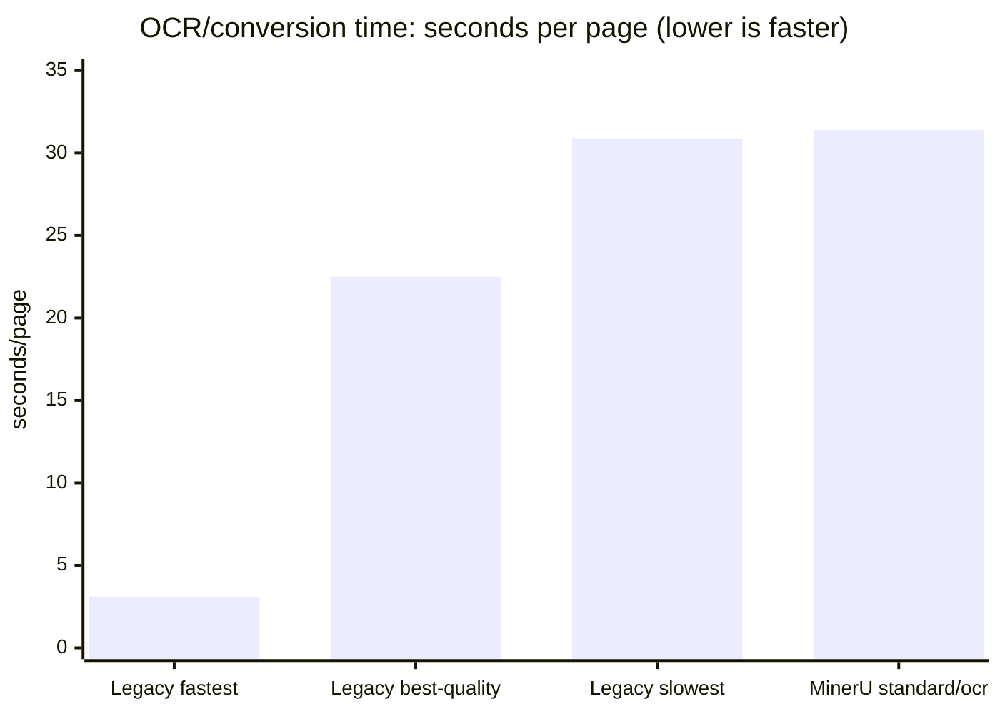

# Legacy OCR versus RAG-Anything/MinerU

This comparison documents the two document-processing paths currently available in
`docingest`. It is a measured engineering comparison, not a controlled model benchmark:
the legacy OCR path was benchmarked on an Apple M4 Pro, while RAG-Anything/MinerU was
validated on the Linux workstation. Hardware and model runtimes are therefore different.

## What is being compared?

| Concern | Legacy `docingest ingest` + OCR | RAG-Anything/MinerU `ingest-async` |
|---|---|---|
| Entry point | `docingest ingest` | `docingest ingest-async` |
| Processing unit | PDF page | Whole document |
| OCR engine | `mlx-vlm` in-process VLM, Apple Silicon | MinerU 4 `mineru-kit`, local `llama-cpp-engine` on Linux |
| Routing | Per-page: preserve a usable text layer and OCR only pages that need it | Parser runs over the document with `tier` and `ocr_mode` |
| Main output | Normalized Markdown and page manifest | Normalized Markdown, manifest, bounded raw parser output, and optional structured layout JSON |
| Layout information | Page-level routing/probe metadata; OCR text is primarily linear | Page blocks, equations, tables, figures, images, and source-page metadata can be retained |
| Circuit extraction readiness | Requires later extraction from OCR/Markdown | Better starting point because layout blocks and image references are preserved |
| Platforms | Best fit for Apple Silicon | Best fit for the Linux GPU workstation |
| Failure behavior | OCR guards detect truncation, loops, empty output, and retry where configured | Explicit subprocess and output errors; MinerU runtime failures remain visible |

The legacy implementation is a page OCR adapter, not a complete document-layout parser. RAG-Anything
is a document conversion path with OCR and layout analysis. This distinction matters more than the
library name: the newer path produces a richer intermediate representation.

## Measured results

### Legacy OCR measurements

The existing OCR benchmark was run on an Apple M4 Pro with 24 GB using `mlx-vlm`. In the
olmOCR-Bench screening run, the measured median throughput ranged from **3.1 to 30.9 seconds
per page**, depending on the model. The best quality result was `qwen3.5-9b` at **83.0% pass
rate and 22.5 seconds/page**. The fastest candidate, `paddleocr-vl`, achieved **3.1 seconds/page
and 55.3% pass rate**. These figures are summarized from
[the existing OCR benchmark](benchmark.md).

### RAG-Anything/MinerU measurements

The same project branch was pushed as commit `21a4c5e` and pulled onto the Linux workstation.
MinerU 4 processed an 8-page corpus PDF with:

- `tier = "standard"`
- `ocr_mode = "ocr"`
- local `llama-cpp-engine`
- `middle_json` output enabled

The direct MinerU run completed in **251.4 seconds**, or approximately **31.4 seconds/page**,
and produced a **120,187-byte structured JSON** result. The project-level
`docingest ingest-async` smoke test also completed successfully in `flash`/`txt` mode in
**7.6 seconds**; that mode reads an existing PDF text layer and is **not an OCR measurement**.

An `ingest-async` run with `standard`/`ocr` reached VLM inference but terminated with exit code
`-11` on its second local invocation. This is recorded as a runtime stability issue, not hidden
as a successful result. The standalone MinerU `standard`/`ocr` command succeeded on the same
machine and input.

## Speed graphic

The chart uses the measured median legacy OCR values and the measured RAG/MinerU direct run.
It is intentionally labeled by hardware/path; it must not be read as a same-machine ranking.



## Which one is better?

### Better output: RAG-Anything/MinerU

For the research-engine objective, RAG-Anything/MinerU is the better **output pipeline** when
the input is scanned, contains figures/tables/equations, or needs circuit extraction later.
It preserves structured parser output and layout artifacts instead of reducing every page to
linear OCR text. It also runs on the Linux workstation, where the legacy `mlx-vlm` adapter is
not the appropriate runtime.

The quality conclusion is about **representation and downstream usefulness**, not a claim that
MinerU has a higher character-level OCR score. A controlled accuracy comparison still requires
the same corpus, same hardware class, fixed models, and ground-truth scoring.

### Faster path: conditional

- For born-digital PDFs with a reliable text layer, **MinerU `flash`/`txt` is fast** and the
  smoke test completed in 7.6 seconds for one 8-page document. It does not OCR scans.
- For scanned PDFs requiring OCR, the measured MinerU run was about **31.4 seconds/page**.
  That is slower than the fastest legacy models and close to the slowest legacy benchmark
  candidates, but the comparison uses different machines and workloads.
- The legacy path can be faster when only a few pages require OCR because its routing is
  page-selective. It is also simpler when the desired output is only cleaned page text.

## Recommendation

Use the paths this way:

1. **Scanned PDFs, images, tables, figures, equations, and circuit research:** use
   RAG-Anything/MinerU with `standard`/`ocr`, retain structured output, and enable
   `require_layout = true` when layout data is mandatory.
2. **Born-digital PDFs with a good text layer:** use the regular ingestion path or
   RAG-Anything/MinerU `flash`/`txt` when whole-document conversion is useful.
3. **Apple Silicon page-selective OCR with a text-only objective:** use the legacy
   `mlx-vlm` path.

The RAG-Anything adapter now supports the same practical split for PDFs when
`method = "auto"`: it inspects the PDF text layer before launching MinerU. A PDF with text uses
`flash`/`txt`; a PDF without text uses the configured OCR settings, normally
`standard`/`ocr`. This avoids spending VLM OCR time on normal arXiv PDFs while retaining Linux
OCR for scanned documents and images. `method = "txt"` forces the text-only path, while an
explicit non-`auto` method uses the configured tier and OCR mode.

## MinerU output/runtime errors

The most useful distinction is between a parser output error and a process crash:

- **Missing Markdown:** ensure the adapter invokes `mineru-kit parse` with
  `--format markdown` and an output path inside a writable, document-specific directory. The
  current adapter does this and reports an explicit `ConversionError` if the file is absent or
  empty.
- **Missing structured JSON:** use a MinerU format that emits it (`middle_json` or `zip`) for a
  direct CLI diagnostic. Markdown mode is sufficient for normalized text, but
  `require_layout = true` correctly rejects a Markdown-only result.
- **Exit code `-11`:** this is a native segmentation fault, not a recoverable Markdown parse
  error. Check available RAM/VRAM, avoid concurrent MinerU processes, run one document at a time,
  and reduce the input to a one-page reproduction. Also verify the selected tier/model files and
  test the direct command separately from the Python wrapper. The Linux smoke run showed that
  direct `standard`/`ocr` succeeded, while a repeated project subprocess ended in `-11`; the
  failure must remain visible rather than being treated as successful OCR.
- **Repeated model crashes:** restart the worker between documents if the native runtime does not
  release memory, keep `max_concurrency = 1`, and prefer `flash`/`txt` for text-layer PDFs.
  Do not silently downgrade a scan to text-only mode.

Do not call the `flash`/`txt` timing an OCR win, and do not claim a universal speed winner
until both implementations are benchmarked on the same machine, input set, model budget, and
quality metric.

## Reproducing the measurements

Legacy benchmark:

```bash
uv run docingest bench run --config packages/docingest/config/benchmark.toml
```

RAG-Anything/MinerU direct parse:

```bash
uv run mineru-kit parse "$PAPER" \
  -o "$OUT/parsed" \
  --format middle_json \
  --tier standard \
  --ocr-mode ocr
```

Project smoke test:

```bash
uv run docingest ingest-async "$PAPER" --config "$RESEARCH_ENGINE_CONFIG"
```
